# User manual (MDMS-Cy, Team 12)

[← Back to the menu](../README.md) · Task: DOC-1 in [tasks.md](tasks.md) · Deliverable list: [18-deliverables-and-timeline.md](18-deliverables-and-timeline.md)

> **Status: complete.** Every page named here was checked against `sources/`, and the screenshots were taken from the running
> local demo with `img/manual/shoot.py` (rerun it after the demo database is rebuilt). Screenshots show demo data and the
> display names of the demo users.

This manual is the printed user manual of the assignment (section V). It has the parts the assignment asks for:
how to use the system (sections 1–10), design choices (11), extra features (12), difficulties (13), the final ER and the
data dictionary (14), and limitations and improvements (15). The UI is in Greek, so every button and menu entry is quoted
exactly as it appears on screen.

## Contents
1. [Getting started](#1-getting-started)
2. [Consumer](#2-consumer)
3. [Technician](#3-technician)
4. [Operator (system operator)](#4-operator-system-operator)
5. [Admin](#5-admin)
6. [DSO (distribution operator)](#6-dso-distribution-operator)
7. [TSO (transmission operator)](#7-tso-transmission-operator)
8. [Supplier](#8-supplier)
9. [Aggregator](#9-aggregator)
10. [A full walk-through for the demo](#10-a-full-walk-through-for-the-demo)
11. [Design choices](#11-design-choices)
12. [Extra features](#12-extra-features)
13. [Difficulties we met](#13-difficulties-we-met)
14. [Final ER and data dictionary](#14-final-er-and-data-dictionary)
15. [Limitations and possible improvements](#15-limitations-and-possible-improvements)

---

## 1. Getting started

**Address.** The demo runs at `https://students.cs.ucy.ac.cy/~sharal01/mdms/` (CS VPN needed). The first page is the login page.

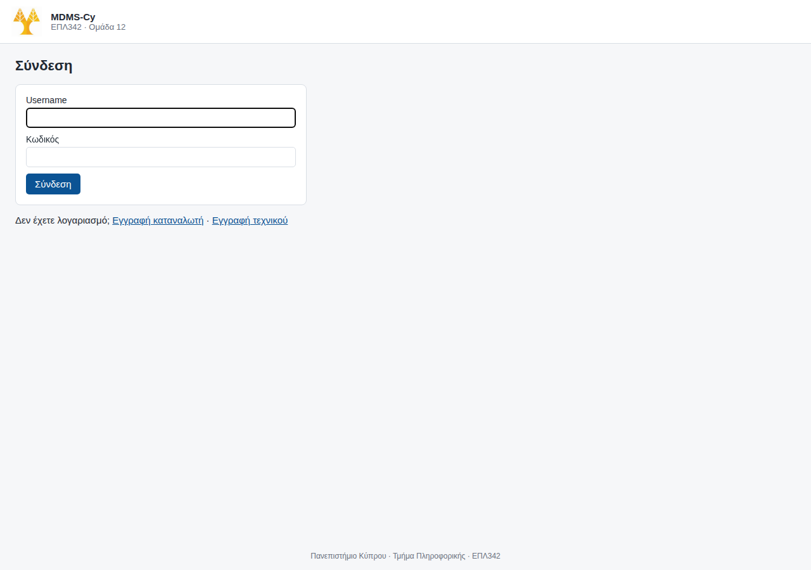
*Login page.*

**Demo users.** The base data (`data/small/00_base.sql`) creates one user per role. All share one test password, written in
the header of that file (it is nobody's real password).

| Username | Role | Notes |
|---|---|---|
| `admin` | Admin | |
| `operator` | Operator | |
| `consumer1`, `consumer2` | Consumer | own premises with installed meters |
| `tech1` | Technician | already approved |
| `tech2` | Technician | still **Pending**: cannot log in until the Operator approves |
| `dso1` | DSO | |
| `tso1` | TSO | |
| `supplier1` | Supplier | |
| `aggregator1` | Aggregator | |

**Login and the menu.** After login every user sees only the menu of **their own role** (one username = one role). Every page
checks the role again on the server, so typing the address of another role's page shows an error, not the page.

**Pages every user has.**
- **Profile** (`profile.php`): your details and **«Αλλαγή κωδικού»** (current password, new password, «Αλλαγή»).
- **Logout** (`logout.php`).

**Registration (no login needed).**
- **Consumer** (`register_consumer.php`): username, email, first and last name, phone, password twice, «Εγγραφή».
  The account is active at once.
- **Technician** (`register_technician.php`): the same plus date of birth, photo (file path) and the technician's
  categories. After «Εγγραφή» the account is **Pending**: the technician can log in only after the Operator approves them (4.1).

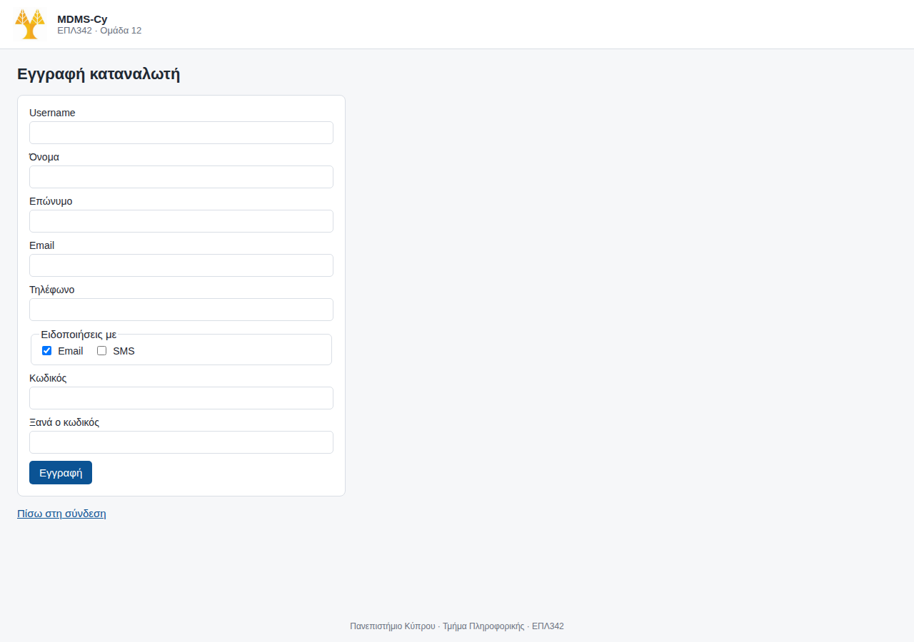
*Consumer registration.*

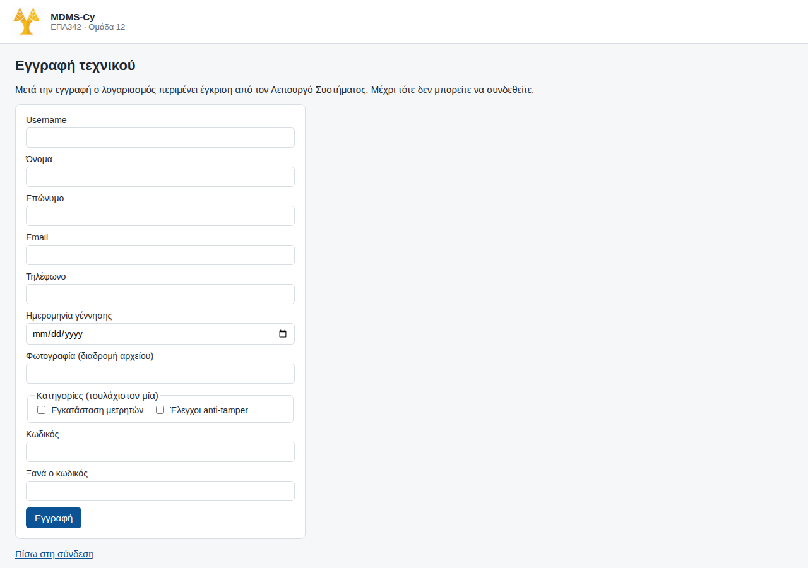
*Technician registration.*

**Messages.** A green message means the action was saved; a red one is the reason it was refused, written by the database
procedure (for example a wrong role, a value out of range or a step done in the wrong order).

---

## 2. Consumer

| Menu entry | What you do there |
|---|---|
| «Τα υποστατικά μου» | List your premises; add a premise; end your holding of a premise |
| «Τραπεζικοί λογαριασμοί» | Add and list your bank accounts (IBAN) |
| «Αιτήματα ελέγχου / βλάβης» | Submit a check or fault request for a premise or meter; follow or cancel it |
| «Τιμολόγια και πληρωμές» | See invoices by year, pay an invoice, see your payments |
| «Μετρήσεις» | See 15-minute readings, history totals, buy older history |
| «Όρια και ειδοποιήσεις» | Consumption thresholds and notification channels (email/SMS) |
| «Συμβάντα ποιότητας» | Power-quality events of your meters |
| «Δικαίωμα στη λήθη» | GDPR request to delete your personal data |

**2.1 Premises.** Under «Νέο υποστατικό» fill address, postal code, «Επαρχία / Δήμος / Ενορία» (chosen from a list), latitude and
longitude, «Χρήση» (use of the premise), «Σχήμα προμήθειας» (supply scheme) and optionally the start date, then «Προσθήκη».
The table lists your premises; «Λήξη» ends your holding (for example when you move out). Ending a holding does not delete the
premise: the next holder can be added later, and the old data stay with the period you held it.

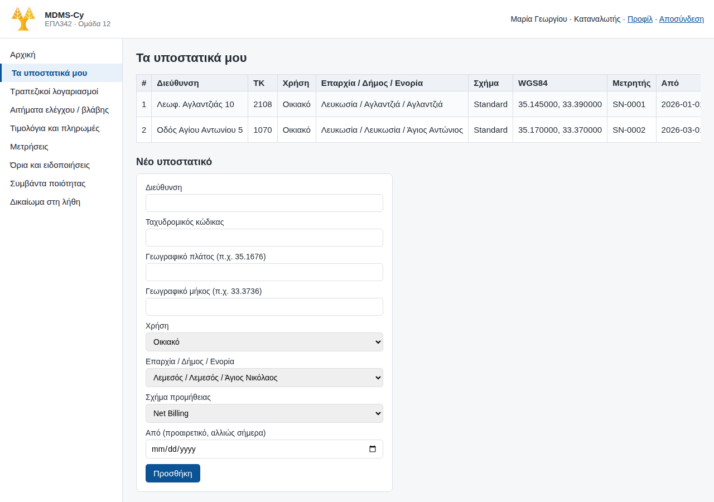
*Consumer: «Τα υποστατικά μου».*

**2.2 Bank accounts.** IBAN, holder name, and optionally the premise the account pays for, then «Προσθήκη».

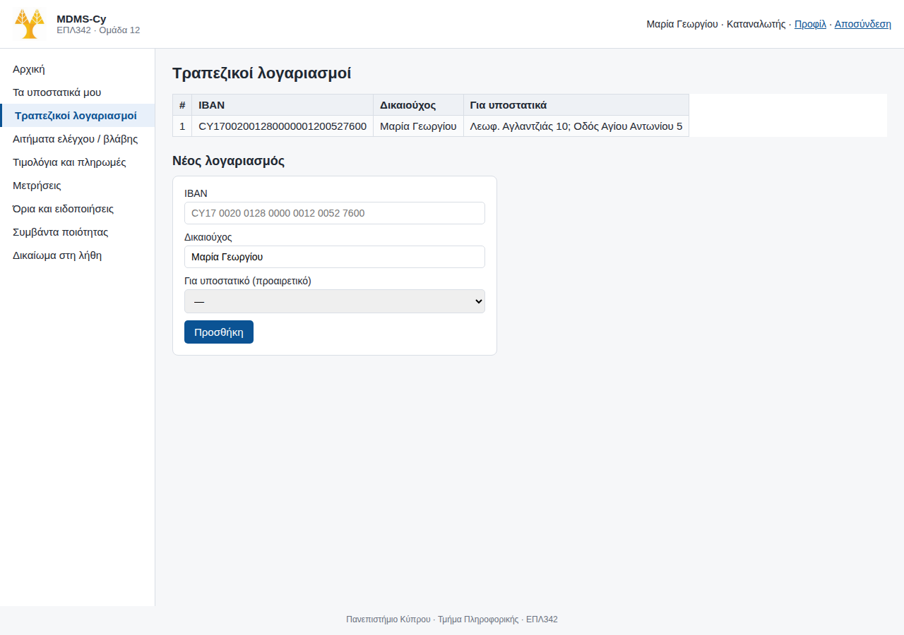
*Consumer: bank accounts.*

**2.3 Requests.** Choose «Είδος» («Έλεγχος μετρητή» or «Αναφορά βλάβης»), «Για» (which premise or meter) and write a description, then «Υποβολή».
The Operator turns a request into a field task for a technician (4.3). Open requests can be cancelled with «Ακύρωση».

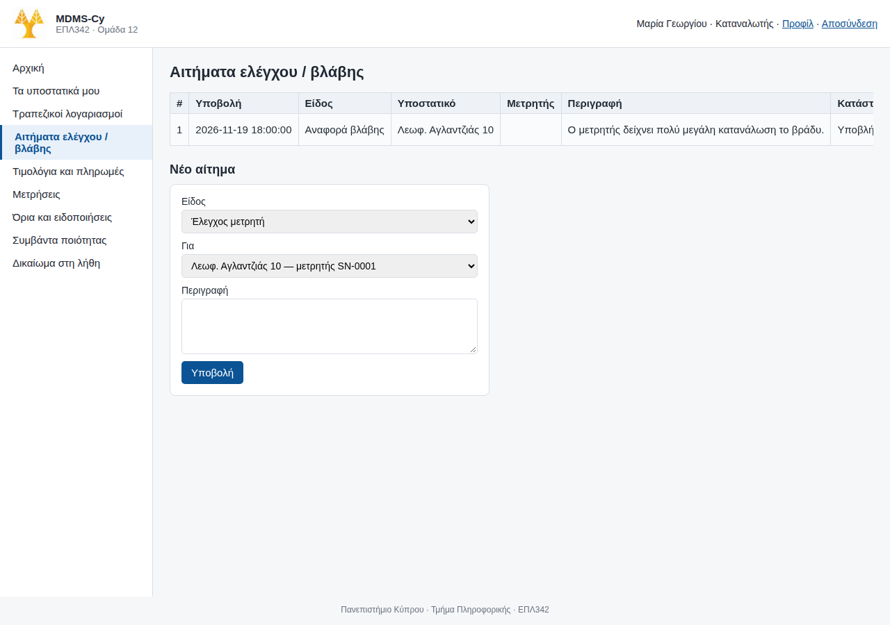
*Consumer: check / fault requests.*

**2.4 Invoices and payments.** Choose a year and «Φίλτρο». An unpaid invoice has a «Πληρωμή» button: pick the bank account
and the amount. If you have no account yet the page asks you to add one first. Payments are listed under «Πληρωμές».

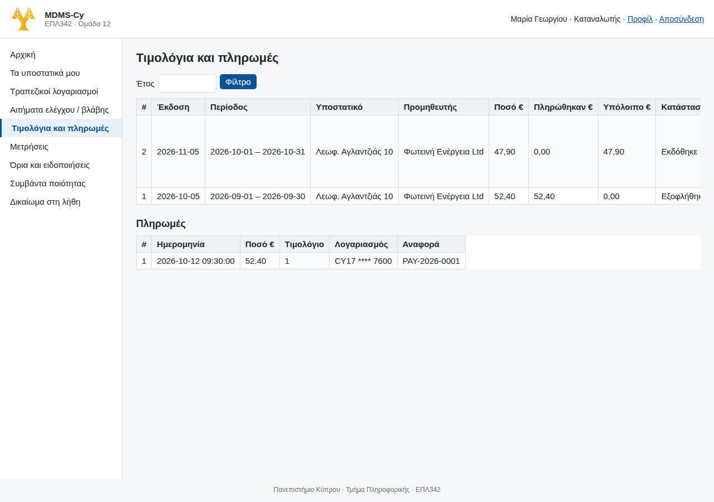
*Consumer: invoices and payments.*

**2.5 Readings.** Choose «Υποστατικό» and a period, then «Εμφάνιση».
- «Μετρήσεις 15 λεπτών»: up to 31 days at a time. **The current month is free**; older months need bought history.
- «Αγορά ιστορικού»: choose «Από μήνα» and «Έως μήνα», then «Αγορά». The charge is per month; an invoice is issued
  and you pay it from «Τιμολόγια και πληρωμές».
- «Ιστορικό (αθροίσματα)»: day, month or year totals for the months you have bought.
- «Οι αγορές μου»: what you have bought and its invoice.
You only ever see the meters installed on **your** premises and only for the period **you** held them, and only data that
are still within the retention period (section 7.2).

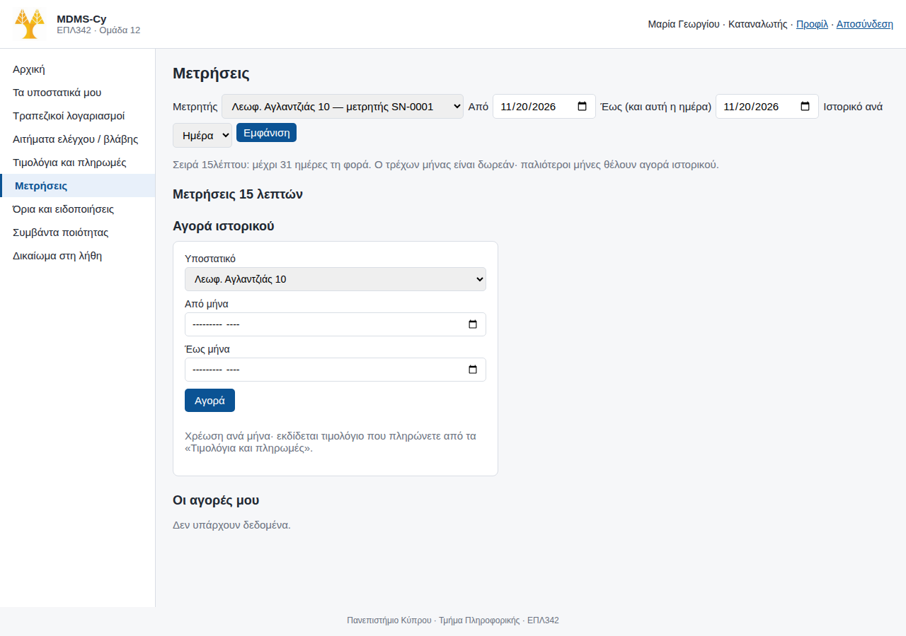
*Consumer: readings.*

**2.6 Thresholds and notifications.** Under «Νέο / αλλαγή ορίου» choose premise, «Περίοδος» and «Όριο (kWh)», then
«Αποθήκευση». One active threshold per premise and period: saving the same pair again changes it. «Αφαίρεση» removes one.
Under «Κανάλια ειδοποίησης» tick email and/or SMS. The database records what must be sent; the actual sending is outside
the database (assumption from Phase A).

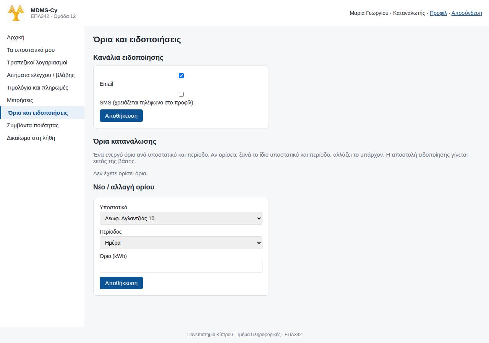
*Consumer: thresholds and notification channels.*

**2.7 Quality events.** Choose a period and «Εμφάνιση»: voltage and other events of your meters, newest first, times in UTC.

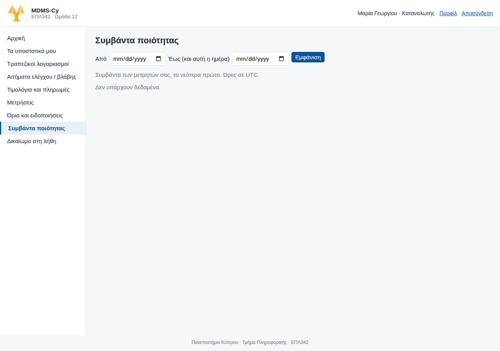
*Consumer: quality events.*

**2.8 GDPR, right to be forgotten.** Tick the confirmation and press «Υποβολή αιτήματος διαγραφής». It is not executed at once:
the Operator pre-approves it, the Admin decides and applies it (4.4, 5.3). Under «Τα αιτήματά μου» you follow its status.
Only one open request is allowed at a time.

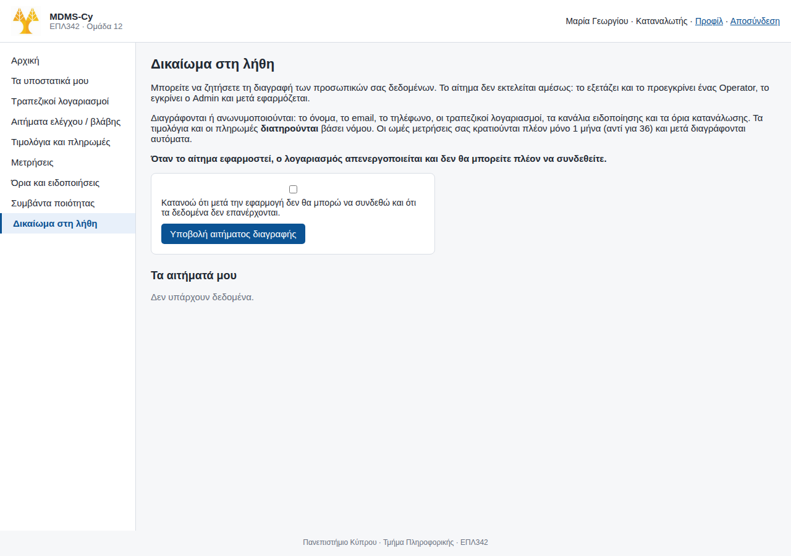
*Consumer: right to be forgotten.*

---

## 3. Technician

| Menu entry | What you do there |
|---|---|
| «Τα έγγραφά μου» | Register your documents (licence, certificates) |
| «Οι εργασίες μου» | Field tasks assigned to you: accept, notes, attachments, complete |
| «Διαθεσιμότητα» | Declare when and where you are available |
| «Εγκατάσταση μετρητή» | Install a meter or replace one, add photos and the 3 equipment documents |
| «Εντολές» | Ask for Disconnect / Reconnect / Firmware upgrade; record an anti-tamper check |

**3.1 Documents.** «Τύπος», «Αριθμός», issue date, expiry date (if any), file path, then «Καταχώριση». The Operator reviews each
document (4.1).

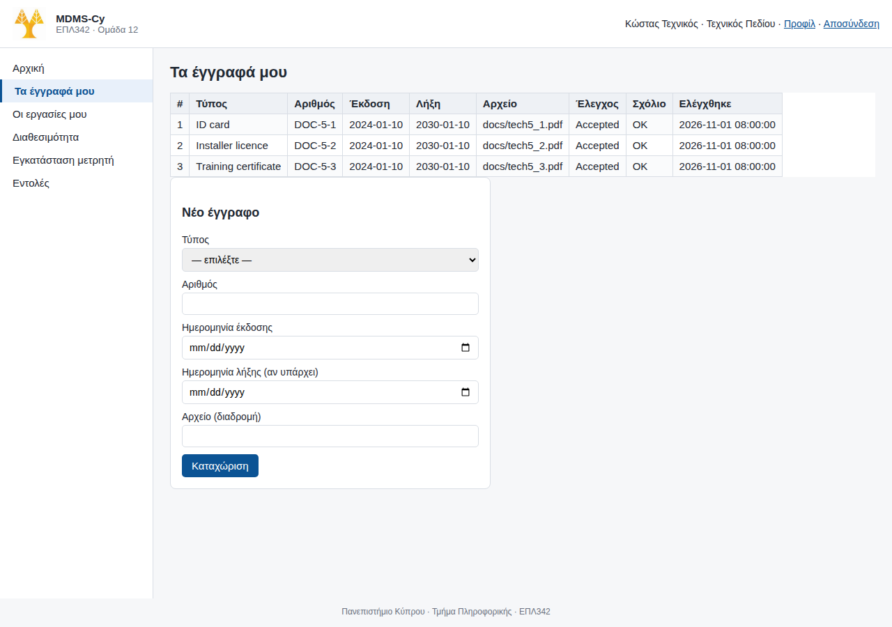
*Technician: documents.*

**3.2 Tasks.** Filter by status with «Φίλτρο». Open a task to see its details, «Σημειώσεις» and «Συνημμένα».
- «Αποδοχή»: you accept a task the Operator assigned to you.
- «Προσθήκη σημείωσης»: free text on the work done.
- «Προσθήκη συνημμένου»: kind, file path and caption (for example a photo of the meter).
- «Ολοκλήρωση εργασίας»: write the result and close the task. A task must be accepted before it can be completed.

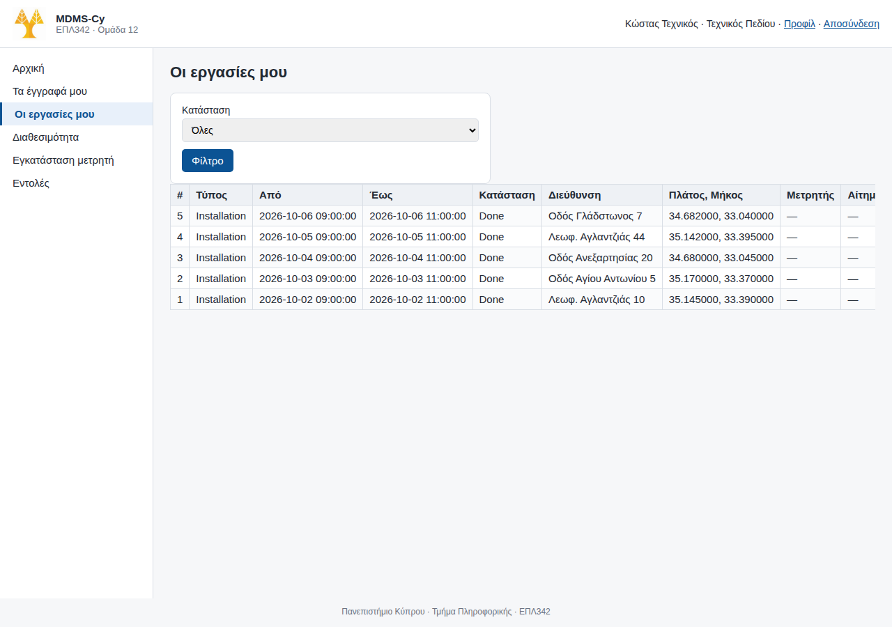
*Technician: tasks.*

**3.3 Availability.** Choose «Ημερομηνία», «Από» and «Έως» and the municipalities you cover, then «Δήλωση». «Διαγραφή» removes
a zone. The Operator sees only technicians available at the time and area of a task when assigning it.

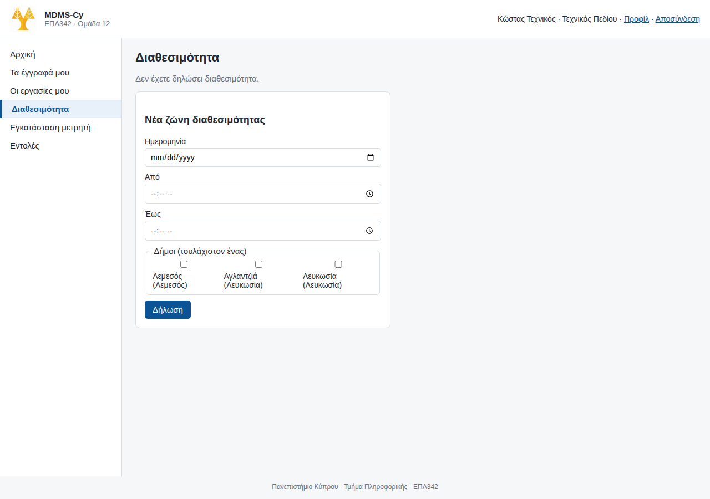
*Technician: availability.*

**3.4 Meter install / replace** («Εγκατάσταση μετρητή»). The page has three parts.
- «Οι εγκαταστάσεις μου»: your installations with the meter status, «Επιβεβαίωση» (Pending / Confirmed), the Operator's
  comment and «Έγγραφα (από 3)», how many of the 3 equipment documents are present.
- «Νέα εγκατάσταση / αντικατάσταση»: first accept an installation or replacement task in «Οι εργασίες μου»; it then appears in
  the «Εργασία» list (a replacement shows the old meter). Fill Serial, Network ID, Firmware, «Μέγιστα Amps», «Πλάτος (lat)»,
  «Μήκος (lon)», «Μοντέλο», «Επικοινωνία» and tick the phases (L1, L2, L3) the model has, then «Καταχώριση μετρητή». The
  transformer is found from the coordinates. The page says that the meter now waits for the Operator. «Προσθήκη φωτογραφίας»
  adds a photo path and caption to the task.
- «Έγγραφα εξοπλισμού μετρητή»: for each meter waiting for confirmation add the three documents, «Πιστοποιητικό βαθμονόμησης»,
  «Δήλωση CE και πρωτοκόλλου» and «Πιστοποιητικό κρυπτογράφησης τηλεμετρίας» (code, issue date, optional expiry, file path),
  with «Προσθήκη εγγράφου».
The meter stays **«Pending confirmation»** and its readings are not accepted until the Operator confirms it (4.5).

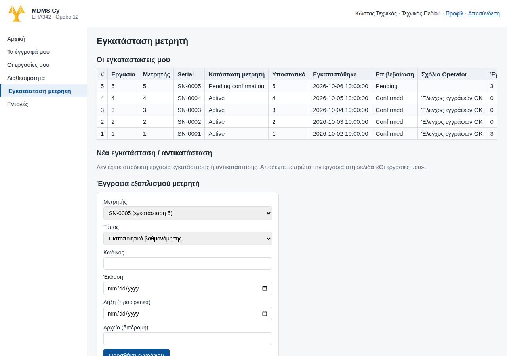
*Technician: meter installation, with one installation waiting for the Operator.*

**3.5 Remote commands and tamper check** («Εντολές»).
- «Νέα εντολή»: choose a meter on which you have an accepted task, the command («Disconnect», «Reconnect» or «Firmware upgrade»),
  optional JSON parameters, then «Αίτηση εντολής». The command first waits as **Awaiting approval** until the Operator approves
  it (4.5); only then it is **Sent**.
- «Οι εντολές μου»: status, number of attempts and last outcome. For a sent command «Καταγραφή προσπάθειας» records one attempt
  (ACK, NAK or Timeout; a device simulation, since there are no real meters); ACK completes it. «Προσπάθειες» lists the attempts.
- «Έλεγχος anti-tamper»: for an accepted task of type *Anti-tamper check* write «Ευρήματα», optionally tick «Κρίσιμο εύρημα»
  (it creates an event for the Operator) and press «Καταγραφή ελέγχου».

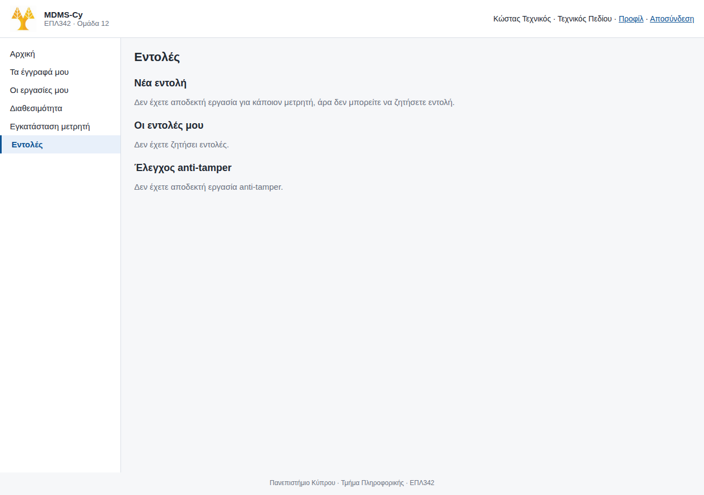
*Technician: remote commands and anti-tamper check.*

---

## 4. Operator (system operator)

| Menu entry | What you do there |
|---|---|
| «Έγκριση τεχνικών» | Approve/reject new technicians, review their documents, suspend/restore |
| «Εργασίες πεδίου» | Create field tasks (also from consumer requests), assign, reassign, cancel |
| «Κατάλογοι» | Catalogs: meter models, service fees, tariffs |
| «Αιτήματα GDPR» | Start review, pre-approve or reject GDPR requests |
| «Επιβεβαίωση μετρητών» | Confirm or reject installed meters (Pending → Active) |
| «Συμβάντα / anti-tamper» | Open events, anti-tamper tasks, approve remote commands |

**4.1 Approving technicians.** The list shows **Pending** technicians. Open one to see their documents: «Αποδοχή» or
«Απόρριψη» for each document, then under «Απόφαση για τον τεχνικό» press «Έγκριση» or «Απόρριψη (απαιτεί σχόλιο)».
For an approved technician, «Αναστολή (απαιτεί σχόλιο)» suspends them and «Επαναφορά» restores them.
Demo: approve `tech2`, then log in as `tech2`.

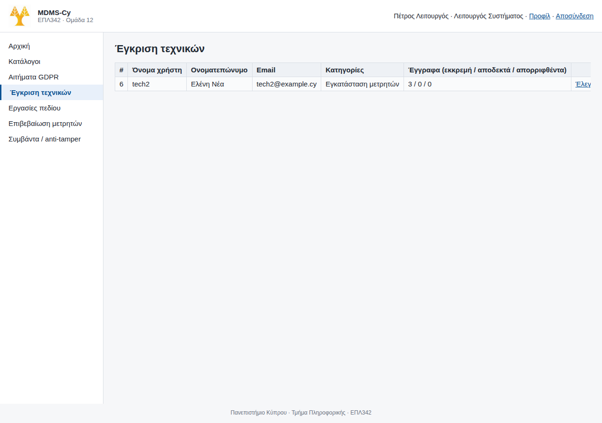
*Operator: technician approval.*

**4.2 Catalogs.** Three tables: «Μοντέλα μετρητών» (manufacturer, model, meter type, phases), «Υπηρεσίες (τέλη)» (name, fee
in €) and «Τιμολόγια» (tariffs). «Αποθήκευση» adds or changes, «Διαγραφή» deletes an item that nothing uses. Changing a fee
does not change past purchases: each purchase keeps its own amount.

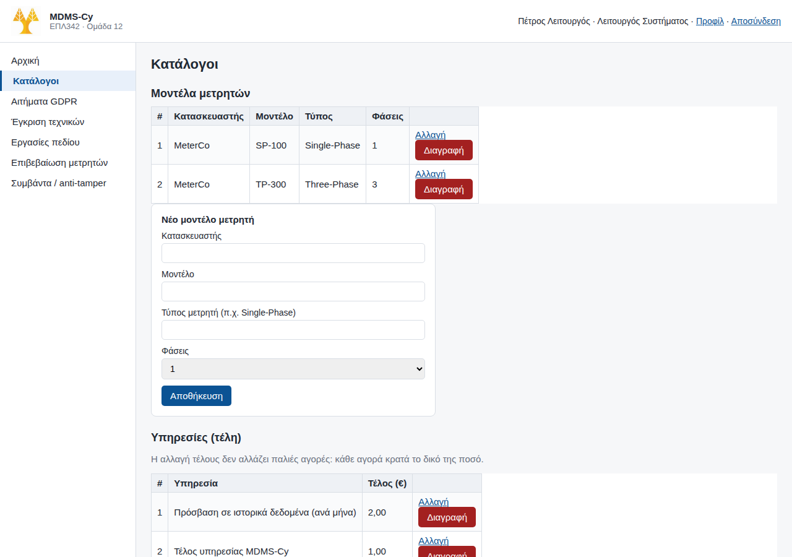
*Operator: catalogs.*

**4.3 Field tasks.** Under «Νέα εργασία» choose «Τύπος», premise, the meter (only for replacement or a check), optionally the
consumer request it comes from (the page lists requests waiting for assignment), the technician (only approved and available
ones), and users to notify. Then «Δημιουργία εργασίας». The list filters by status and dates; «Αλλαγή τεχνικού» reassigns
and «Ακύρωση» cancels a task with a reason.

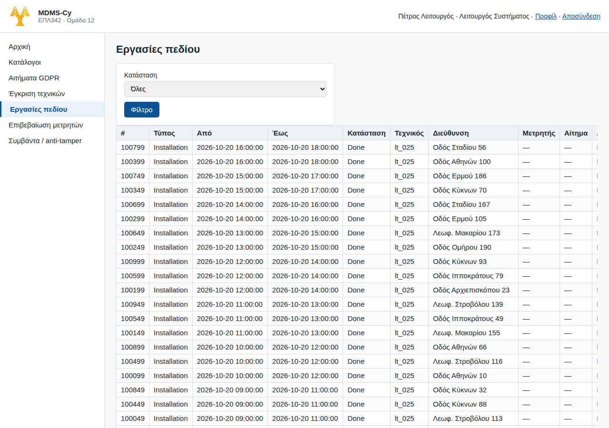
*Operator: field tasks.*

**4.4 GDPR review.** «Έναρξη εξέτασης» marks a request as being examined; then «Προέγκριση» sends it to the Admin, or
«Απόρριψη» with a comment ends it.

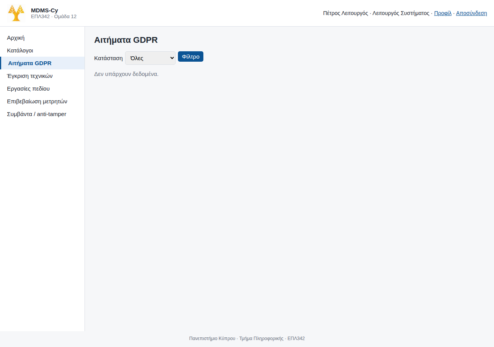
*Operator: GDPR review.*

**4.5 Meter confirmation, events and commands.**
- «Επιβεβαίωση μετρητών» lists installations waiting for confirmation (serial, network ID, firmware, location, transformer,
  premise, technician, how many of the 3 documents and photos). «Έγγραφα» shows the documents of one meter. Write an optional
  comment and press «Επιβεβαίωση»: the meter becomes **Active** and its readings are accepted (all 3 documents must be present).
  «Απόρριψη» needs a comment.
- «Συμβάντα / anti-tamper», «Ανοιχτά συμβάντα»: events not yet handled (tamper findings, grid events). For an event that has a
  meter choose a technician and a time window and press «Δημιουργία εργασίας»: an *Anti-tamper check* task is created and the
  event becomes *In progress*.
- «Εντολές εξ αποστάσεως»: «Έγκριση» sends a command asked by a technician, «Απόρριψη» (comment required) refuses it. For a sent
  command «Καταγραφή προσπάθειας» records ACK, NAK or Timeout; «Προσπάθειες» lists them.

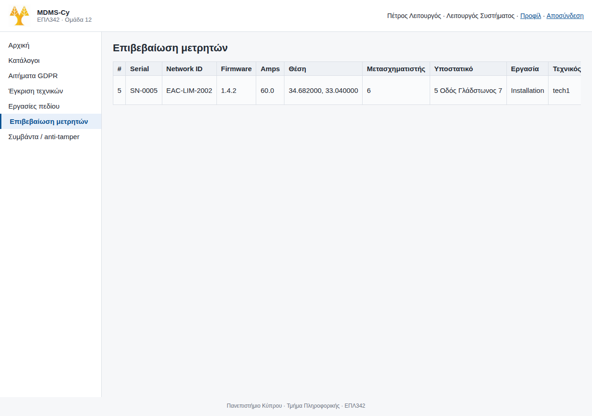
*Operator: meter confirmation.*

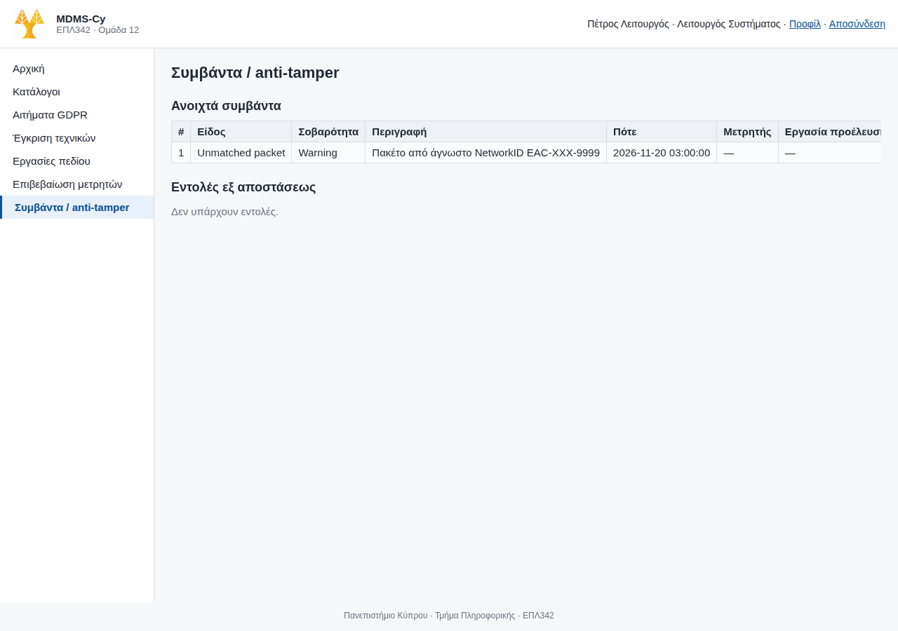
*Operator: events, anti-tamper tasks and remote commands.*

---

## 5. Admin

| Menu entry | What you do there |
|---|---|
| «Χρήστες» | Create staff accounts, suspend/activate any account |
| «Αρχείο καταγραφής» | The audit log of every change |
| «Αιτήματα GDPR» | Final decision on pre-approved GDPR requests and applying them |
| «Διατήρηση δεδομένων» | Data retention: preview and purge old readings |

**5.1 Users.** Under «Νέος λογαριασμός προσωπικού» choose «Ρόλος» (Operator, DSO, TSO, Supplier, Aggregator), the company
where it applies, username, email, names, phone and a password of at least 8 characters, then «Δημιουργία». Consumers and
technicians register themselves (section 1). The list filters by role/status; each row has «Αναστολή» or «Ενεργοποίηση».

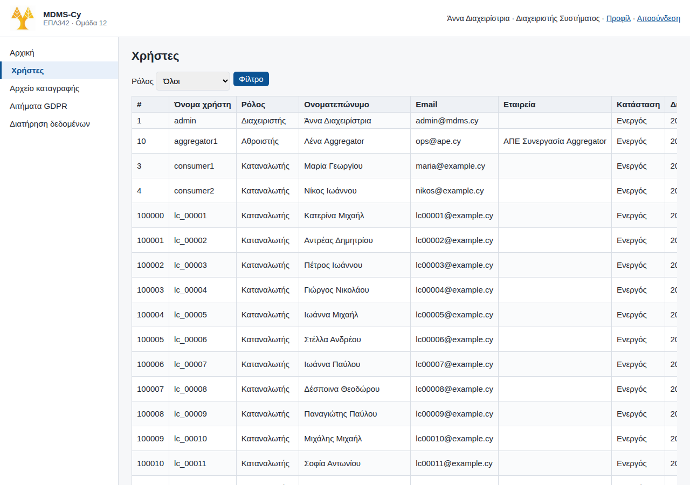
*Admin: users.*

**5.2 Audit log.** The 500 newest events, newest first. Filter by «Τύπος αντικειμένου» and dates. Every state change made
through any page writes one row here (who, when, what, old and new value).

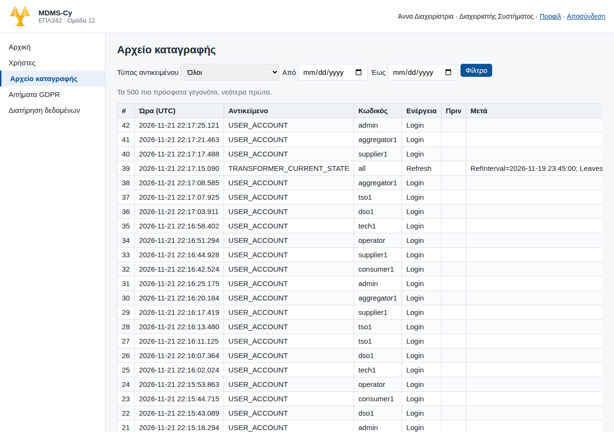
*Admin: audit log.*

**5.3 GDPR decision.** Only requests pre-approved by an Operator appear. «Έγκριση» or «Απόρριψη» with a comment. An approved
request is carried out with «Εφαρμογή» (needs the confirmation tick): the person's name, email, phone, bank accounts and
notification channels are deleted or anonymised, and their raw readings get the short 1-month retention.

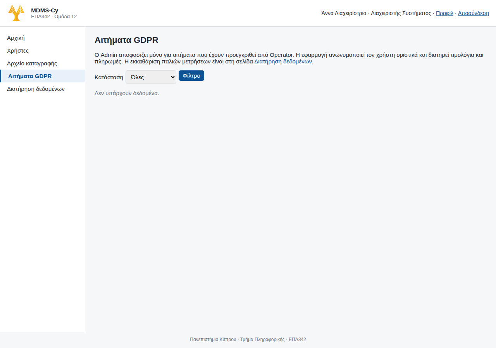
*Admin: GDPR decision.*

**5.4 Retention.** Raw and validated readings are kept **36 months**, or **1 month** after an applied GDPR request.
«Προεπισκόπηση» shows how many rows would be deleted (optionally for a chosen reference date); «Εκκαθάριση τώρα» deletes them.

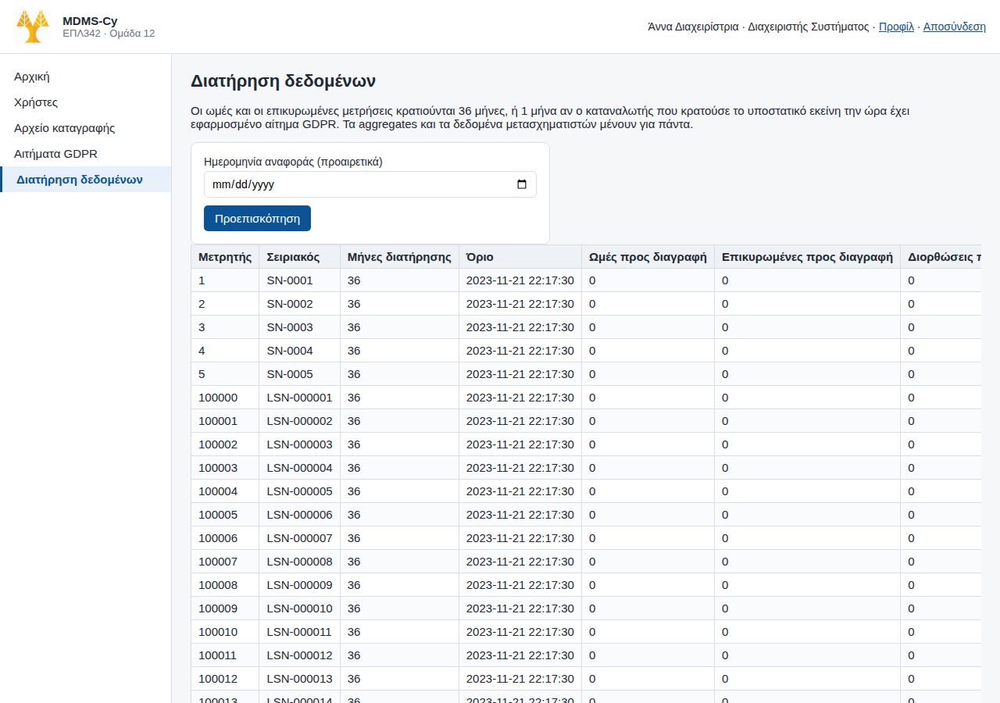
*Admin: data retention.*

---

## 6. DSO (distribution operator)

| Menu entry | What you do there |
|---|---|
| «Εισαγωγή πακέτου» | Paste a meter telemetry packet (JSON) and ingest it |
| «VEE» | Run validation/estimation, see suspect readings, correct them by hand |
| «Aggregates» | Build and view meter and leaf-transformer aggregates |
| «Συμβάντα δικτύου» | Detect and list grid events, technical-losses report |

**6.1 Ingest.** Paste a packet in the format of the assignment's appendix into «Πακέτο JSON» and press «Αποστολή».
«Αποτέλεσμα» shows how many readings were stored. A packet from an unknown network ID, a non-active meter or with bad JSON is
not lost: it is stored as an event. «Πρόσφατα πακέτα» lists the latest packets.

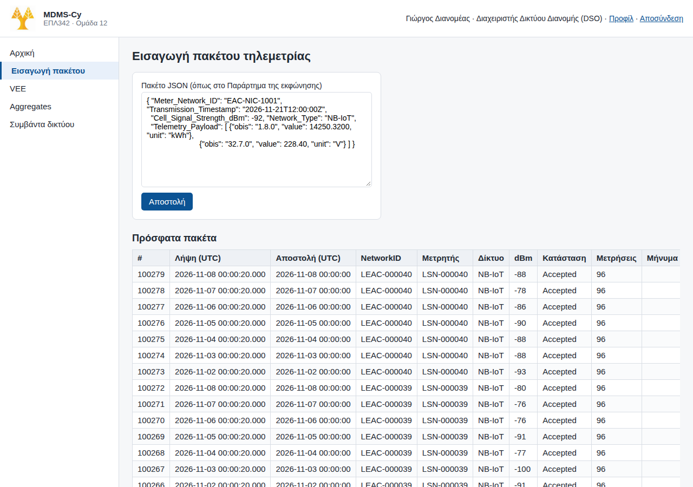
*DSO: ingest.*

**6.2 VEE (Validation, Estimation, Editing).** Under «Εκτέλεση VEE» give «Από» and «Έως» (UTC) and press «Εκτέλεση VEE».
The run checks every raw reading of the period: range, sudden spikes and gaps. Good readings become **validated** (they can
never be changed again); a gap is filled by interpolation; a doubtful value goes to «Ύποπτες μετρήσεις». There the DSO
enters «Νέα τιμή» and «Λόγος» and presses «Διόρθωση». «Τρεξίματα VEE» lists past runs with their counts.
The stored value is the energy of the 15 minutes (for cumulative codes: counter minus previous counter).

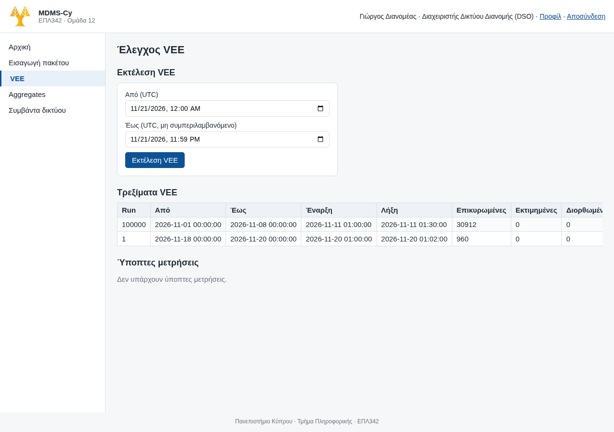
*DSO: VEE.*

**6.3 Aggregates.** Under «Χτίσιμο aggregates ημέρας» choose a day and «Χτίσιμο», or «Χτίσιμο όλων των ημερών που λείπουν
(έως χθες)». This builds the daily total of each meter (and month and year when they complete) and the monthly total of every
**leaf** transformer. Then choose type and dates and «Εμφάνιση» for «Aggregates μετρητών» or «Aggregates μετασχηματιστών (φύλλα)».

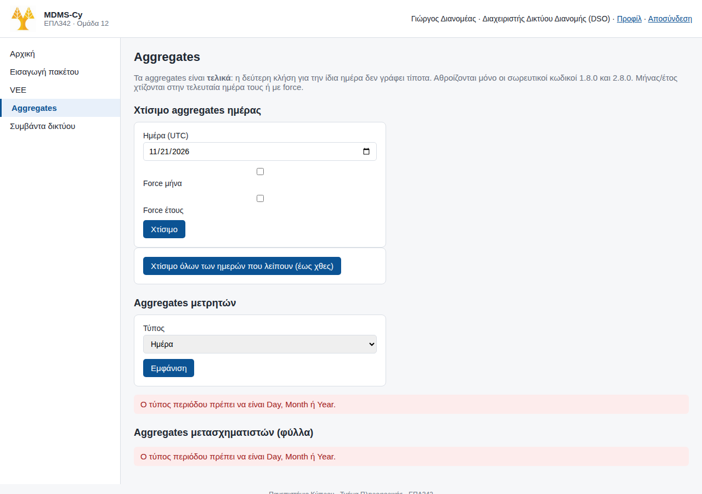
*DSO: aggregates.*

**6.4 Events and losses.** «Ανίχνευση» runs the rules on validated readings: voltage outside 207–253 V, phase-current
imbalance above 25 %, suspected theft and others. «Συμβάντα» lists events by type, status and dates.
«Αναφορά τεχνικών απωλειών» compares each leaf transformer's total with the sum of its meters for the last 7 days.

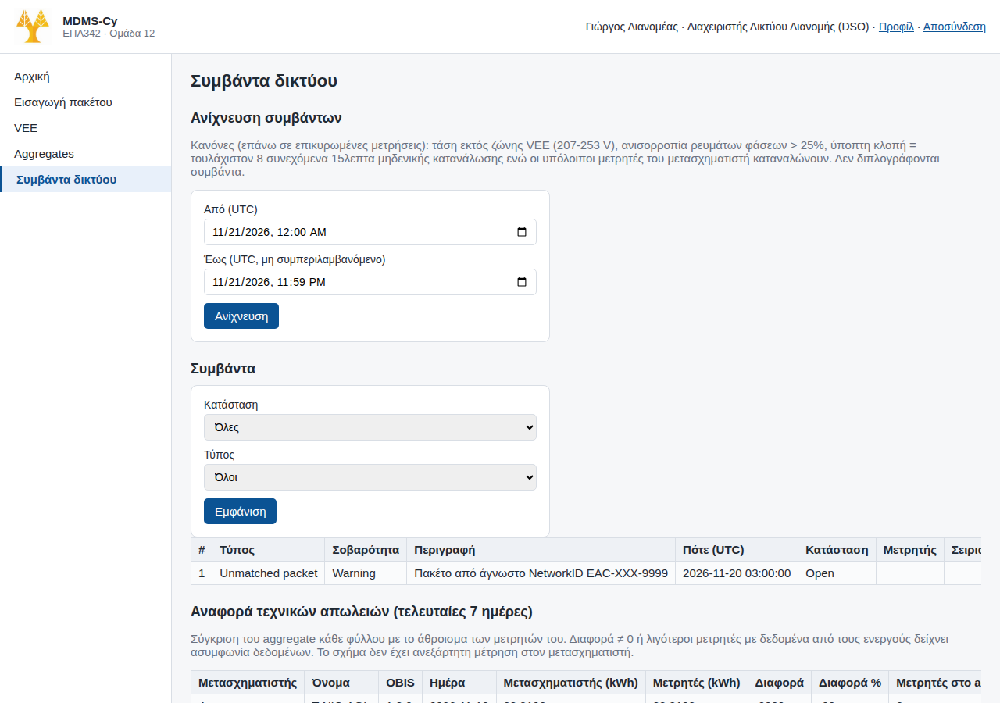
*DSO: grid events and losses.*

---

## 7. TSO (transmission operator)

| Menu entry | What you do there |
|---|---|
| «Δέντρο μετασχηματιστών» | The transformer tree; add a transformer with its geofence; locate by coordinates |
| «Τρέχουσα κατάσταση» | Current load of every transformer, refreshed on demand |
| «Aggregates δικτύου» | Totals at any level of the tree for month, quarter or year |
| «Load shedding» | Disconnect every meter below a transformer |
| «Χάρτης δικτύου» | Map of geofences, transformers and meters (bonus) |

**7.1 Tree.** The page shows the tree from the root down. Under «Νέος μετασχηματιστής» give the name, «Κωδικός γονέα» (empty only
for the first root), the geofence name and its rectangle (minimum/maximum latitude and longitude). The geofence must lie inside
the parent's geofence and the parent must not have meters (only leaves have meters). «Εύρεση μετασχηματιστή από συντεταγμένες»
returns the leaf transformer whose geofence contains a point.

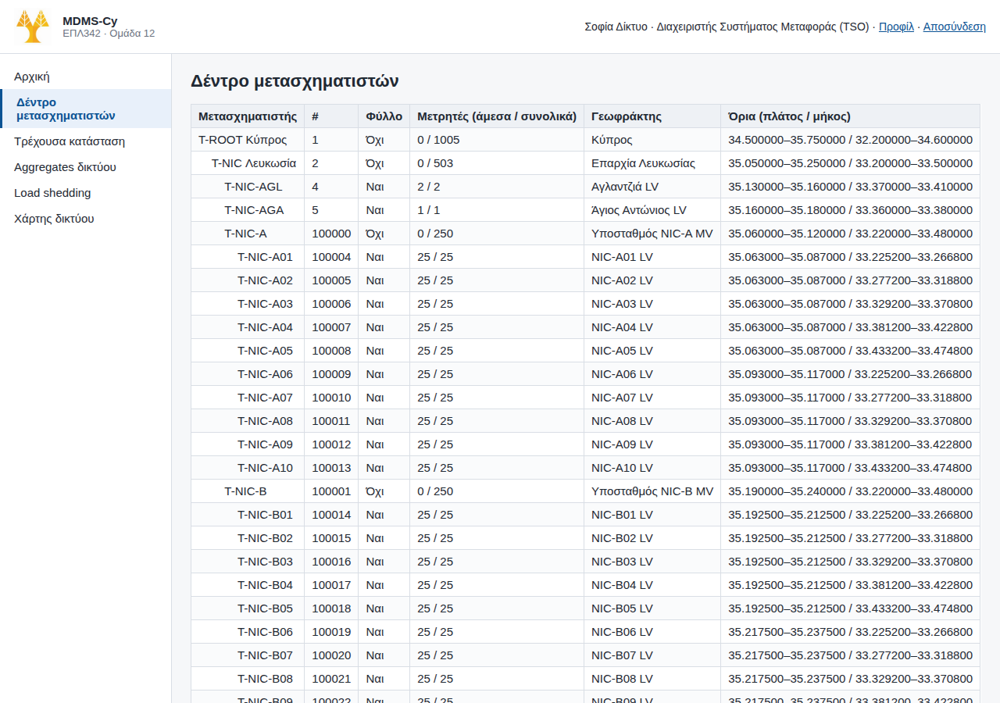
*TSO: transformer tree.*

**7.2 Current state.** «Ανανέωση τρέχουσας κατάστασης» computes the load of each leaf from its meters and adds it up the tree,
so every level shows its total. It runs only when the button is pressed; meters with no reading in the reference interval are
left out.

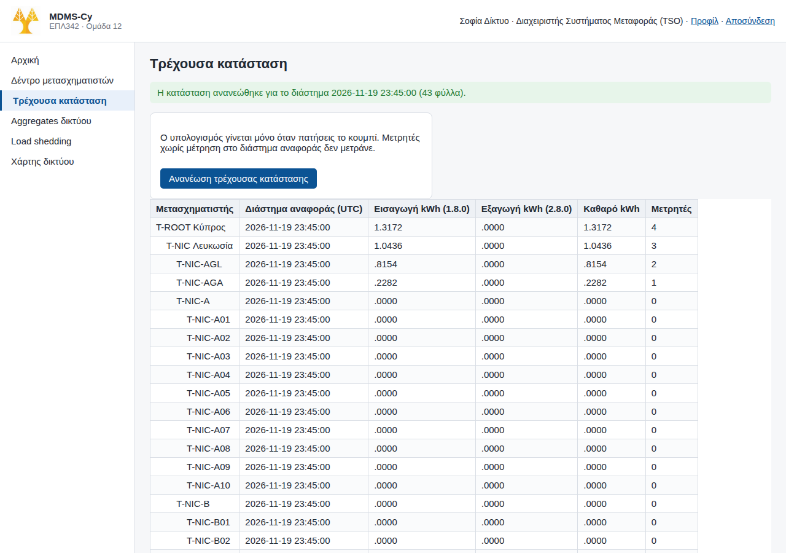
*TSO: current state after the refresh button.*

**7.3 Aggregates.** Choose «Μετασχηματιστής» (any level), «Περίοδος» (month, quarter, year) and the dates, then «Εμφάνιση».
Leaves have stored monthly totals; higher levels are summed on demand. Months, quarters and years are taken whole.

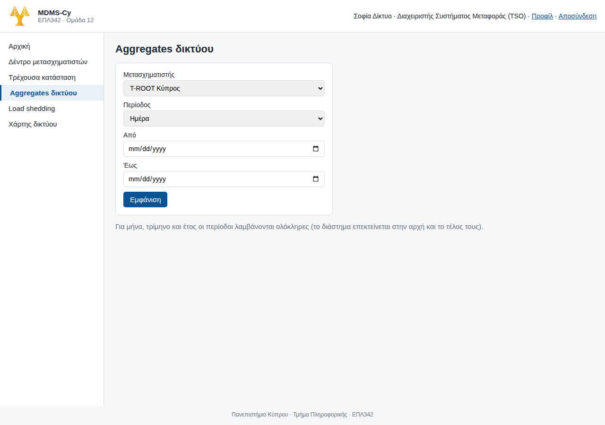
*TSO: network aggregates.*

**7.4 Load shedding.** Choose the transformer, write «Αιτιολογία», tick the confirmation and press «Αποστολή εντολής».
A remote command of type `Load shed` is created for every meter in its subtree, all linked to one shed order. «Εντολές αποκοπής» lists past orders.

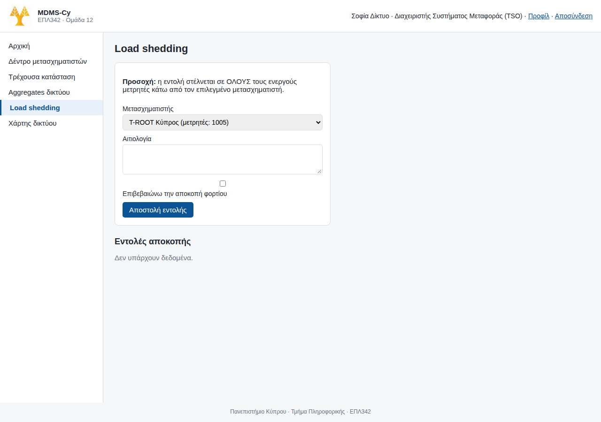
*TSO: load shedding.*

**7.5 Map.** A Leaflet map: filled rectangles are leaf geofences, dashed ones higher levels, markers are transformers and meters.

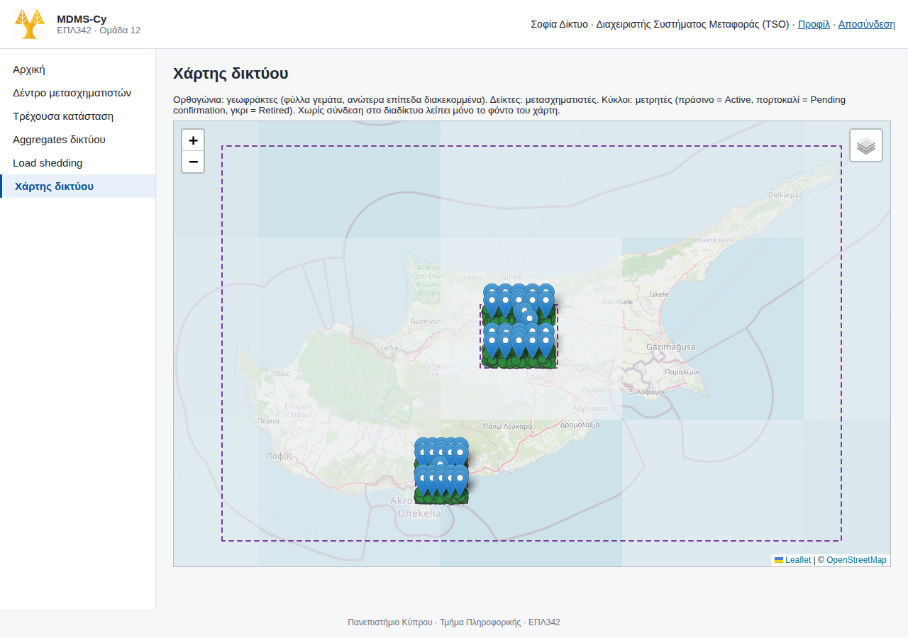
*TSO: network map.*

---

## 8. Supplier

| Menu entry | What you do there |
|---|---|
| «Day-Ahead» | Validated totals of your customers per period and per transformer |
| «Intraday» | Provisional 15-minute values of one day, before VEE |

**Day-Ahead.** Choose «Περίοδος» and dates, «Εμφάνιση». «Σύνολα ανά περίοδο» and «Ανά περίοδο και μετασχηματιστή» show
**only totals** of validated data, never one consumer's readings (privacy).
**Intraday.** Choose a date: «Προσωρινά δεδομένα (πριν το VEE)» shows the newest raw values, which may still change after VEE.

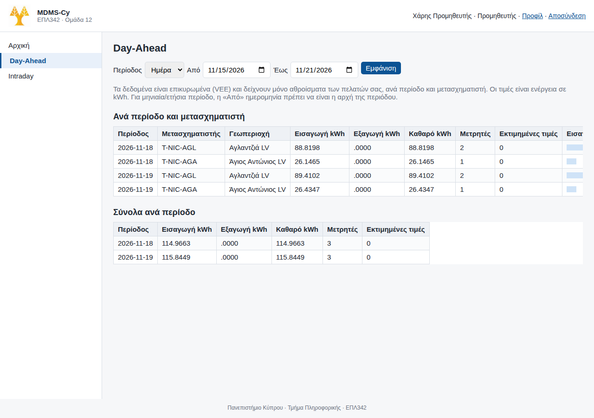
*Supplier: Day-Ahead.*

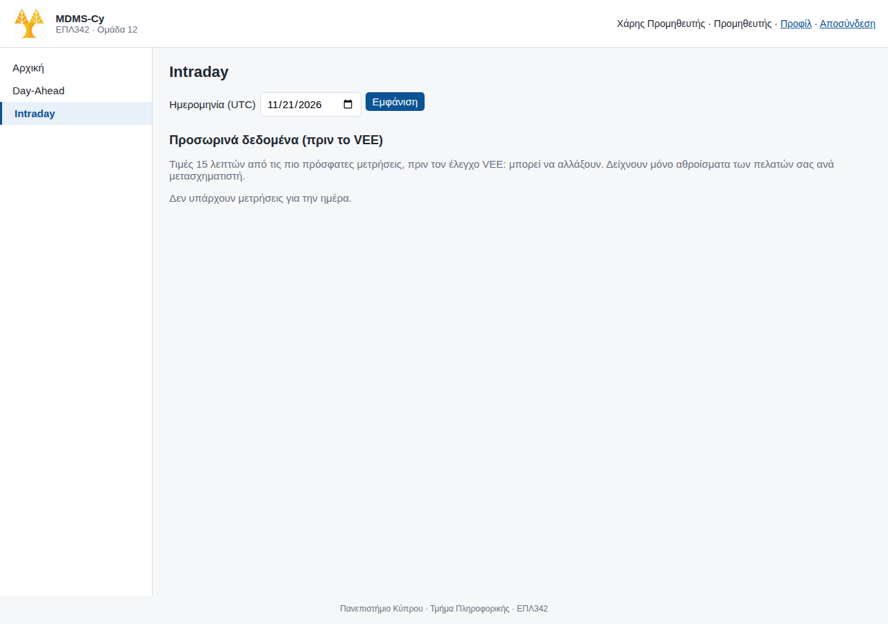
*Supplier: Intraday.*

## 9. Aggregator

The same two pages as the Supplier, for the premises in the aggregator's portfolios, plus:

**«Χαρτοφυλάκια».** «Νέο χαρτοφυλάκιο» with a name and «Δημιουργία»; «Μετονομασία» renames. Open a portfolio, give
«Αριθμός υποστατικού» and optionally «Από», then «Προσθήκη υποστατικού»; «Αφαίρεση» removes one.

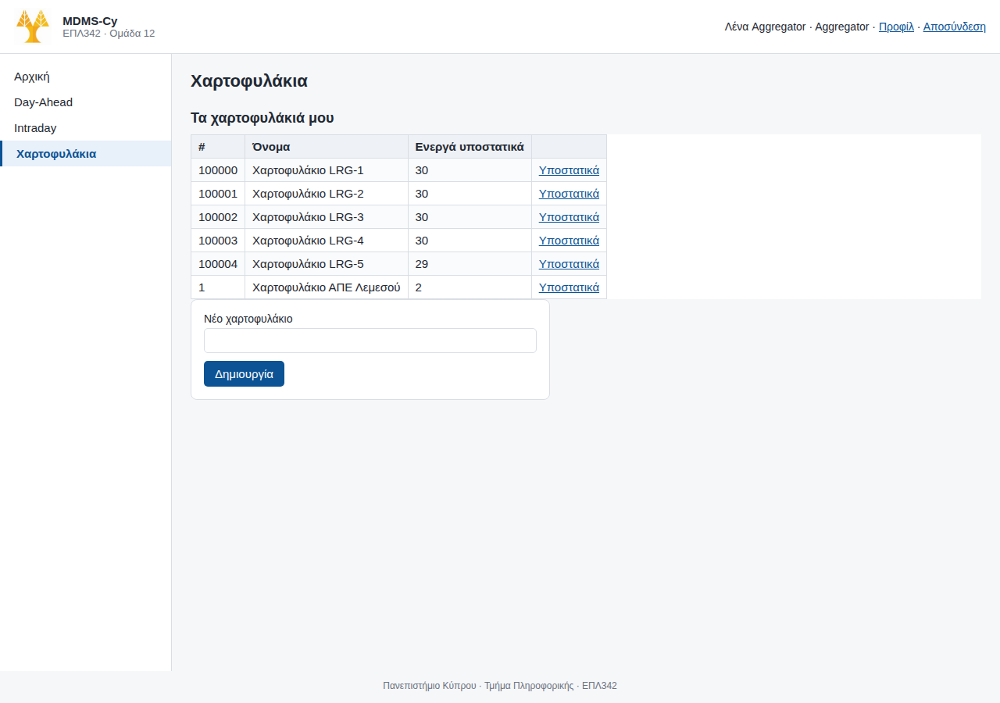
*Aggregator: portfolios.*

---

## 10. A full walk-through for the demo

The order below touches every ★ function once and keeps the data consistent between steps.

1. `consumer1`: «Τα υποστατικά μου», «Μετρήσεις» (current month free), buy one older month, pay the new invoice.
2. `consumer1`: submit a fault request.
3. `operator`: approve `tech2` («Έγκριση τεχνικών»); create a field task from the consumer's request and assign it to `tech1`.
4. `tech1`: accept the task, add a note, complete it. Then «Εγκατάσταση μετρητή»: register the meter and its 3 documents.
4b. `operator`: «Επιβεβαίωση μετρητών» → «Επιβεβαίωση»; the meter is Active.
5. `dso1`: ingest a JSON packet, run VEE for that period, correct one suspect reading, build aggregates, detect events.
6. `tso1`: show the tree, add a transformer, refresh the current state, show quarter aggregates at a higher level,
   load shedding on a small subtree, the map.
7. `supplier1` / `aggregator1`: Day-Ahead totals and Intraday values; create a portfolio and add a premise.
8. `consumer2`: GDPR request → `operator` pre-approves → `admin` approves and applies → `admin` retention preview.
9. `admin`: «Αρχείο καταγραφής», showing the rows that steps 1–8 wrote.

---

## 11. Design choices

- **Everything goes through stored procedures.** Pages never write SQL; they call `sp_<area>_<verb>` procedures with
  parameters (`?`). Each procedure takes the calling user first and checks the role, so the rules live in the database
  and hold even if someone calls the procedure from SSMS.
- **One transaction per action.** Every procedure uses `SET XACT_ABORT ON` and TRY/CATCH: either the whole action is saved
  or nothing. Refusals are `THROW`s with a Greek message, which the page shows in red.
- **Audit log.** Every change of state writes one `AUDIT_LOG` row (who, when, what), shown to the Admin.
- **One username, one role** (professor's feedback): `USER_ACCOUNT.Role` instead of one table per role.
- **Raw → VEE → immutable validated readings.** Meters write `RAW_READING`; only VEE writes `VALIDATED_READING`, which is
  never updated afterwards. A correction is a new edit with a reason, so the history is kept.
- **Strict transformer tree.** Each transformer has one parent; only leaves have meters; geofences follow the tree. Monthly
  totals are stored only for leaves; higher levels are computed on demand with a recursive query.
- **Times in UTC**, readings on :00/:15/:30/:45.
- **Passwords** are stored only as `password_hash()` hashes.
- **Privacy:** a consumer sees only their own meters for the time they held the premise; suppliers and aggregators see only totals.

## 12. Extra features

- **Map of the network** (TSO, Leaflet, bonus): geofences, transformers and meters on a real map, working without internet
  because Leaflet is copied into `sources/lib/leaflet/`.
- **Technical-losses report** and automatic event detection (voltage, phase imbalance, suspected theft).
- **Buying history** creates a real invoice that the consumer pays like any other.
- **Retention preview** before deleting anything.
- **Automatic menu:** each page declares its menu entry in its first line, so a new page appears in the right role's menu
  with no other change.

## 13. Difficulties we met

- **Per-user schemas on the department server.** Each member's objects live in their own schema, so calls written as `dbo.x`
  failed. We removed `dbo.` everywhere and replaced scalar functions with inline table-valued functions.
- **The server name.** `mssql.cs.ucy.ac.cy` without the instance is a different server; the right one is
  `mssql.cs.ucy.ac.cy\SQL2025`.
- **The web server's firewall** answers 403 when a page prints SQL error text, so pages show only the procedure's Greek message.
- **Database size cap (about 27 MB).** The large data set at first did not fit; the real cause was Query Store, which we
  turned off in the build.
- **No `BULK INSERT`** on the department server, so the large data are also produced as `INSERT` scripts.
- **Working in parallel** as three people with AI assistants: we split the work into tasks and lanes, claimed tasks in
  `docs/claims.md`, and required every pull request to be merged by a member who did not write it.

## 14. Final ER and data dictionary

- **Final ER diagram (Chen)** and **relational diagram**, redrawn from the final `create.sql` (task DOC-2):

  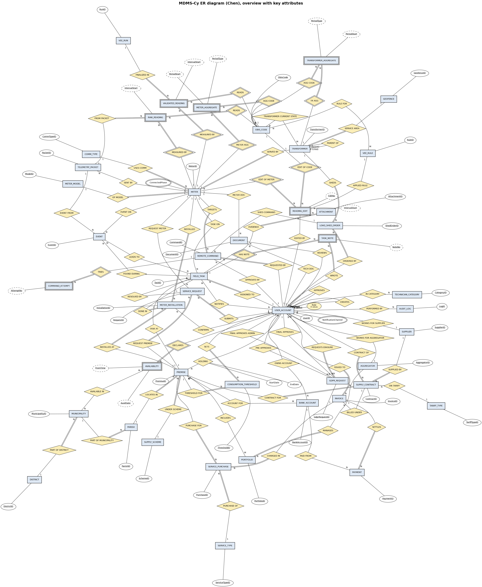

  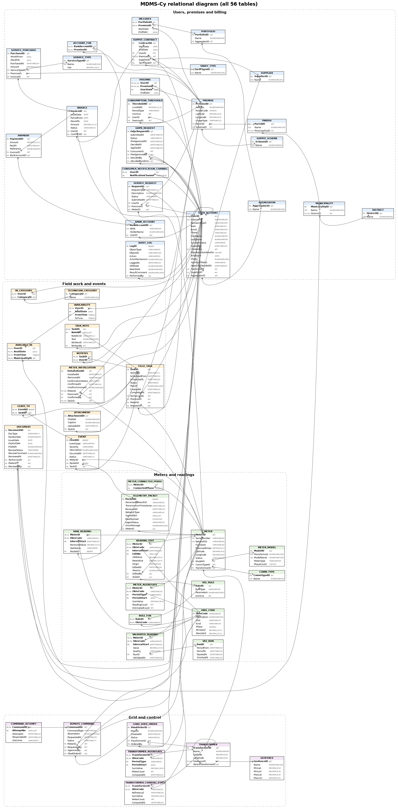

  *(If the images do not show, DOC-2 is not merged yet: the files are `docs/img/er/er-chen.png` and `docs/img/er/relational.png`.)*
- **Data dictionary:** every table and column explained in [20-data-dictionary.md](20-data-dictionary.md).
- Schema overview: [04-database-schema.md](04-database-schema.md).

## 15. Limitations and possible improvements

- **Email/SMS are not really sent.** The database finds what must be sent and stores the channels; a sender service outside
  the database would read it.
- **Files are paths, not uploads.** Documents, photos and attachments store a file path; a real system would upload and store
  the file.
- **No real meters.** Packets are pasted on the DSO page (or loaded from the data set); a real system would receive them
  from the meters' network automatically.
- **VEE, aggregates, current state and event detection run on a button**, not on a schedule. A SQL Agent job (not available
  to students) would run them every 15 minutes or nightly.
- **Rectangular geofences.** Real areas are polygons; SQL Server's `geography` type would allow them.
- **One currency, simple tariffs.** Prices per time of day or tiered tariffs are not modelled.
- **Database login.** The web app uses the member's own SQL login; a production system would use a separate login with
  `EXECUTE` permission only on the procedures (see [16-security.md](16-security.md)).
