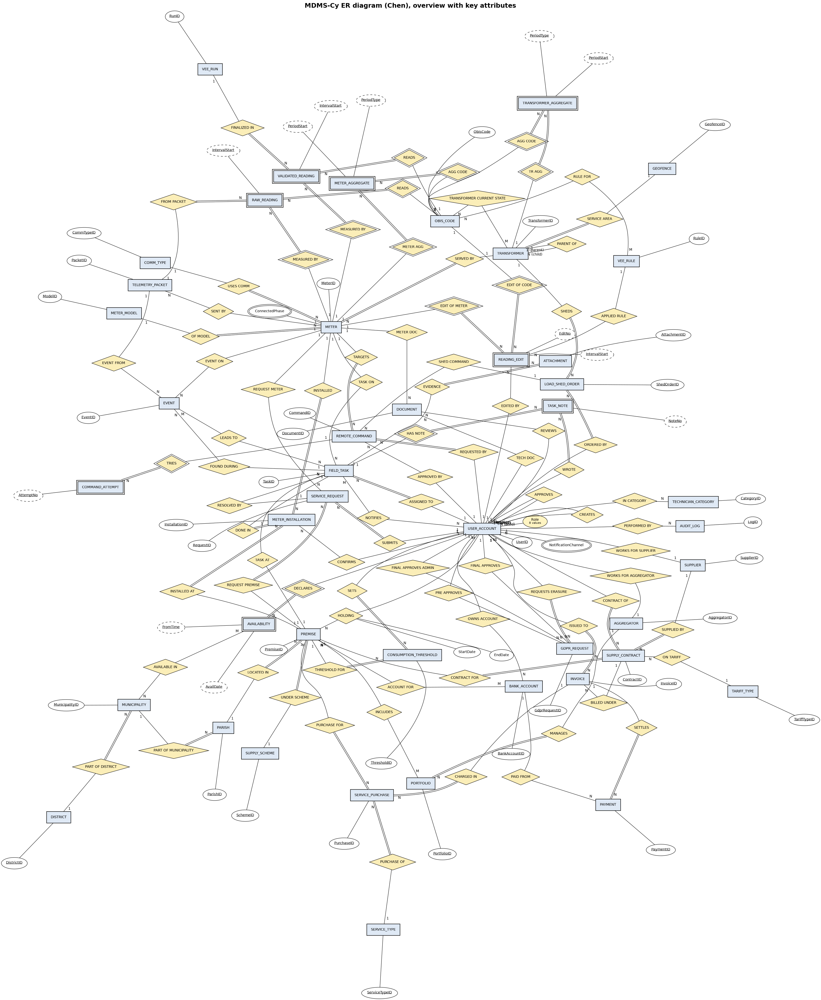
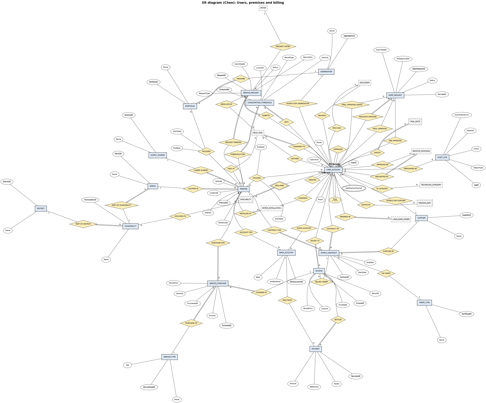
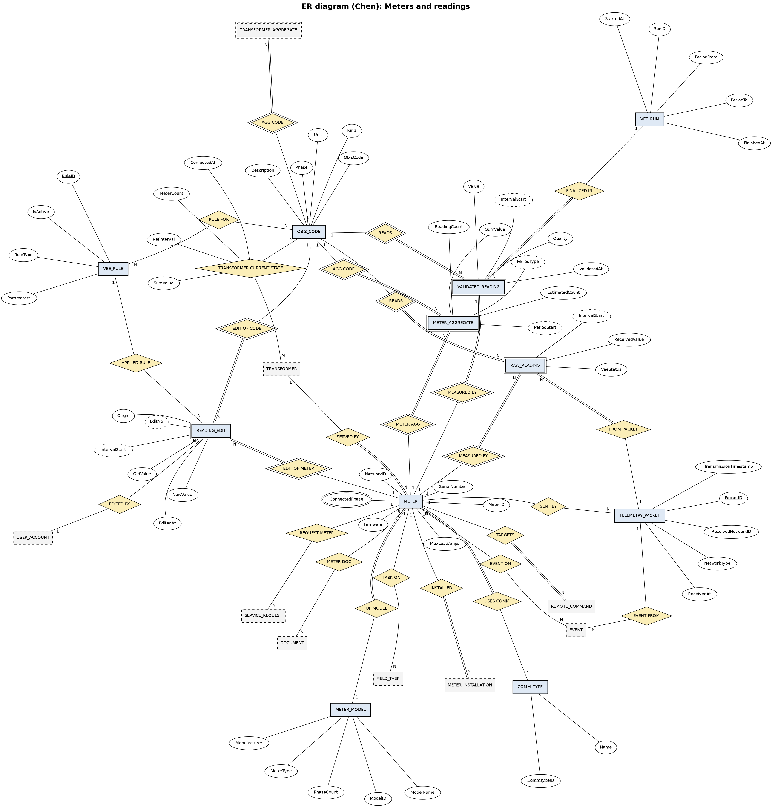
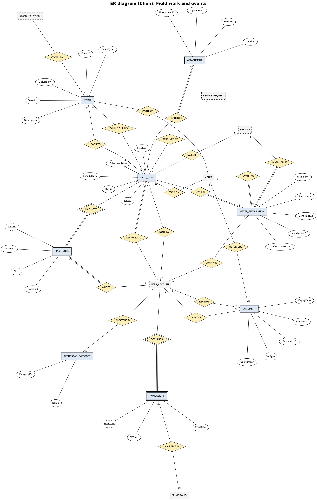
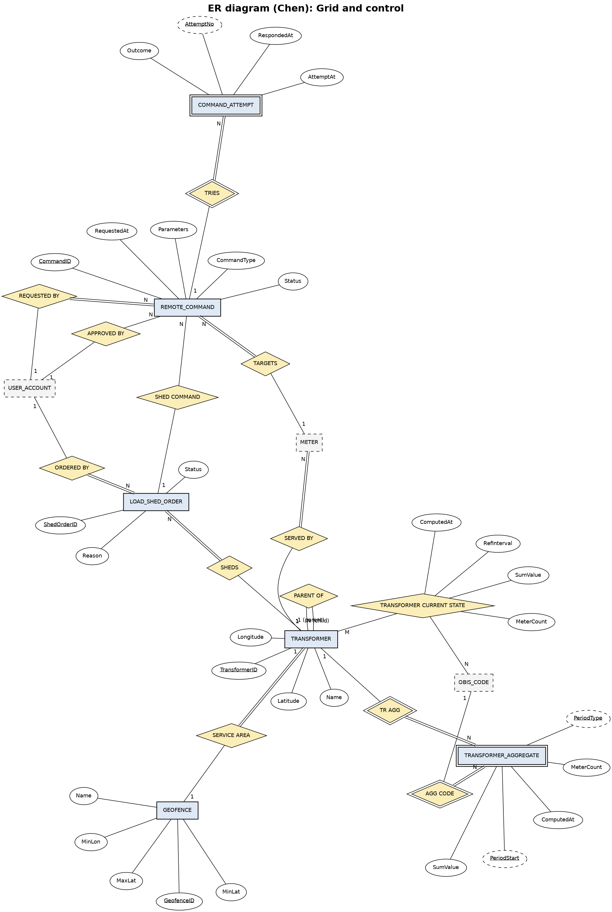
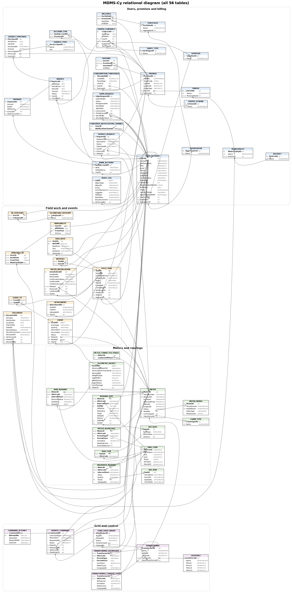
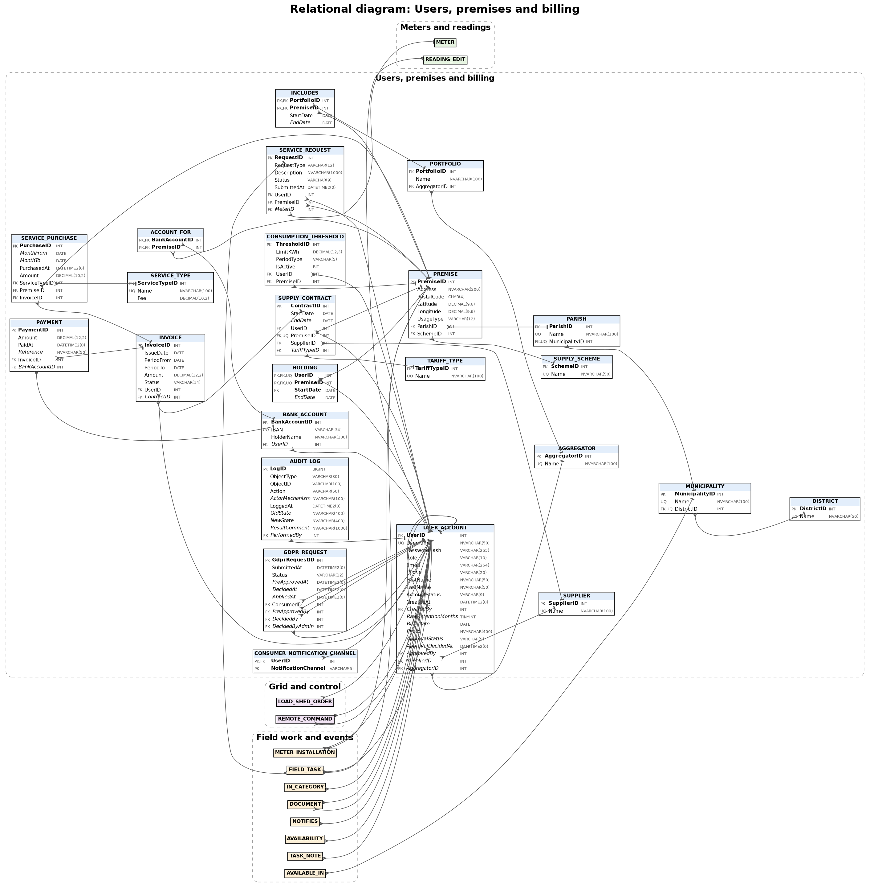
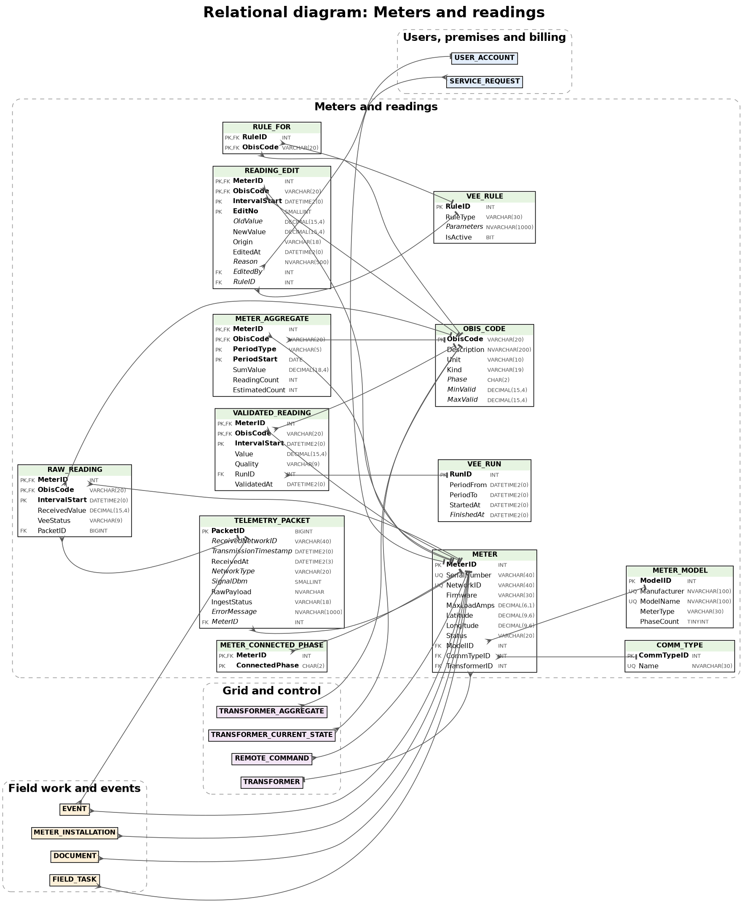
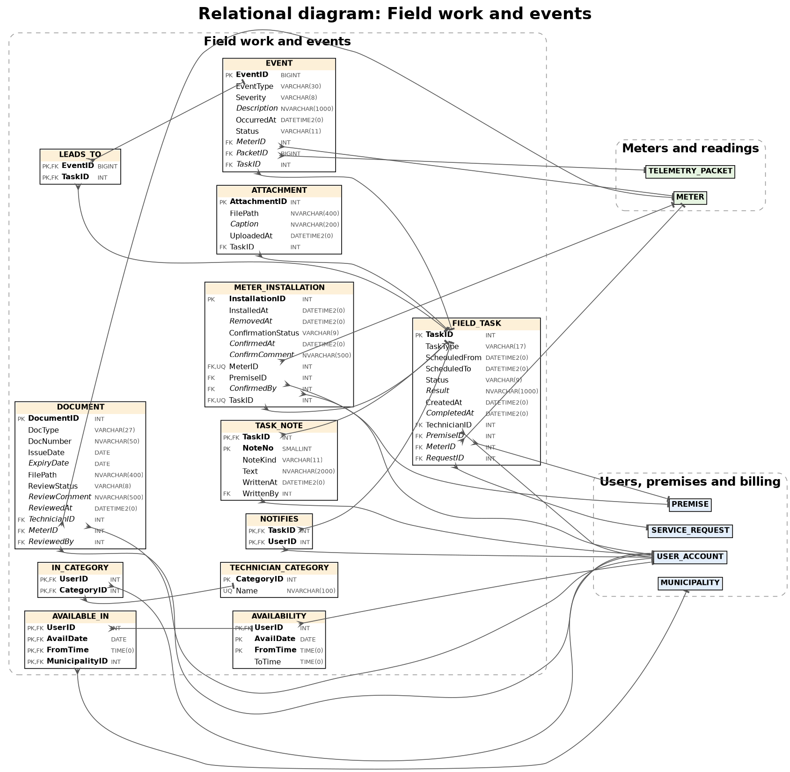
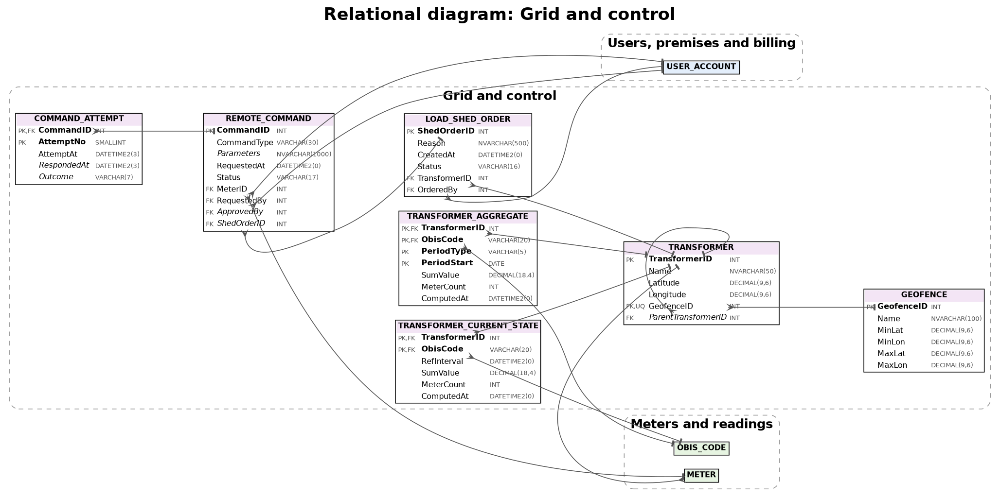

# 22. ER and relational diagrams

[← Back to the menu](../README.md)

> **Status: written (task DOC-2, decision B13).** Drawn from the final [sql/create.sql](../sql/create.sql) (56 tables,
> 96 foreign keys, 106 CHECKs) by [sql/tools/er_diagram.py](../sql/tools/er_diagram.py). Nothing is drawn by hand:
> if the schema changes, run `python sql/tools/er_diagram.py` and commit the new files in `docs/img/er/`.

Two views of the same schema:

- **Chen ER diagram**: the conceptual view. Rectangle = entity, double rectangle = weak entity, diamond = relationship
  (double diamond = identifying relationship), oval = attribute (underlined = key, dashed and underlined = partial key of a weak
  entity, double oval = multivalued). Numbers on a line are the cardinality (1, N, M). A **double line** to an entity means
  total participation (every row must take part, because the foreign key is NOT NULL). Dashed grey rectangles in the area
  pictures are entities that belong to another picture.
- **Relational diagram**: the logical view. One box per table with every column and type. `PK` primary key, `FK` foreign key,
  `UQ` column is in a UNIQUE constraint or unique index, *italic* column may be NULL. Arrows: crow's foot at the table that holds the
  foreign key, bar at the table it points to.

## Pictures

Click a picture for the SVG (sharp at any zoom). Each picture also has its `.dot` source and a `.png` in `docs/img/er/`.

### Chen ER

Overview (all entities, relationships and key attributes; dense around `USER_ACCOUNT`, so four area pictures follow):

[](img/er/er-chen.svg)

Users, premises and billing:

[](img/er/er-chen-users.svg)

Meters and readings:

[](img/er/er-chen-meters.svg)

Field work and events:

[](img/er/er-chen-field.svg)

Grid and control:

[](img/er/er-chen-grid.svg)

### Relational

All 56 tables ([SVG](img/er/relational.svg), large):

[](img/er/relational.svg)

By area, easier to read ([users](img/er/relational-users.svg), [meters](img/er/relational-meters.svg),
[field](img/er/relational-field.svg), [grid](img/er/relational-grid.svg)):

[](img/er/relational-users.svg)
[](img/er/relational-meters.svg)
[](img/er/relational-field.svg)
[](img/er/relational-grid.svg)

## The entities and relationships in words

**Users and companies.** `USER_ACCOUNT` is one entity for every login. Its attribute `Role` has 8 values (Admin, Operator,
Consumer, Technician, DSO, TSO, Supplier, Aggregator); one username has exactly one role. The role-specific columns
(`RawRetentionMonths`, `BirthDate`, `Photo`, `ApprovalStatus`, `SupplierID`, ...) are optional attributes that a row CHECK ties to the
role. The diagram keeps plain ER (no ISA triangle, decision D32 of Phase A). Relationships that only one role can take part in
(a technician is `ASSIGNED_TO` a task, a TSO `ORDERED_BY` a shed order) are drawn to `USER_ACCOUNT`; the stored procedure checks
the role. `USER_ACCOUNT` has two recursive relationships: `CREATES` (an operator creates accounts) and `APPROVES` (a technician is
approved by an operator). `WORKS_FOR_SUPPLIER` and `WORKS_FOR_AGGREGATOR` link a supplier or aggregator login to its company
(`SUPPLIER`, `AGGREGATOR`; exactly one of them for those roles). `CONSUMER_NOTIFICATION_CHANNEL` (Email, SMS) is a multivalued
attribute of the account.

**Geography and premises.** `DISTRICT` 1:N `MUNICIPALITY` 1:N `PARISH` (`PART_OF_...`, total). `PREMISE` is `LOCATED_IN` a parish and
`UNDER_SCHEME` a supply scheme. `HOLDING` is the M:N relationship between consumer and premise with `StartDate` (part of the key)
and `EndDate`, so a premise can change hands and one consumer can return later (a filtered unique index allows one open holding per
pair). `CONSUMPTION_THRESHOLD` is set by (`SETS`) a consumer for (`THRESHOLD_FOR`) a premise.

**Billing.** `SUPPLY_CONTRACT` ties consumer, premise, supplier and tariff (`CONTRACT_OF`, `CONTRACT_FOR`, `SUPPLIED_BY`, `ON_TARIFF`).
`INVOICE` is `ISSUED_TO` a consumer and may be `BILLED_UNDER` a contract. `PAYMENT` `SETTLES` an invoice and is `PAID_FROM` a
`BANK_ACCOUNT`; `ACCOUNT_FOR` is the M:N link between bank account and premise. `SERVICE_PURCHASE` (a paid MDMS-Cy service for a
premise) is `PURCHASE_OF` a `SERVICE_TYPE` and `CHARGED_IN` an invoice. `SERVICE_REQUEST` (meter check or fault report) is `SUBMITS`
by a consumer for a premise, optionally about a meter. `PORTFOLIO` is `MANAGES` by an aggregator and `INCLUDES` premises (M:N with
dates). `GDPR_REQUEST` has four links to `USER_ACCOUNT`: the consumer who asks (`REQUESTS_ERASURE`) and the accounts that pre-approve,
decide, or decide as admin. `AUDIT_LOG` is `PERFORMED_BY` an account.

**Meters.** `METER` is `OF_MODEL` a `METER_MODEL`, `USES_COMM` a `COMM_TYPE` and `SERVED_BY` a `TRANSFORMER` (a trigger allows only leaf
transformers). `METER_CONNECTED_PHASE` (L1, L2, L3) is a multivalued attribute. `METER_INSTALLATION` is the history of a meter at a
premise (`INSTALLED`, `INSTALLED_AT`, `CONFIRMS`, `DONE_IN` a field task, 1:1). `TELEMETRY_PACKET` is `SENT_BY` a meter. `OBIS_CODE`
says what a reading measures.

**Readings (raw, VEE, validated).** `RAW_READING`, `VALIDATED_READING` and `READING_EDIT` are weak entities of `METER` and `OBIS_CODE`
(two identifying relationships each; partial key `IntervalStart`, and `EditNo` for edits). `RAW_READING` also comes `FROM_PACKET`;
`VALIDATED_READING` is `FINALIZED_IN` a `VEE_RUN`; `READING_EDIT` is `EDITED_BY` an account and `APPLIED_RULE` a `VEE_RULE`.
`RULE_FOR` is the M:N link between rule and OBIS code. `METER_AGGREGATE` and `TRANSFORMER_AGGREGATE` are weak entities of
meter or transformer and OBIS code with partial keys `PeriodType` and `PeriodStart`.

**Grid.** `GEOFENCE` (a rectangle) is the `SERVICE_AREA` of exactly one `TRANSFORMER` (1:1). `TRANSFORMER` has the recursive
`PARENT_OF` (strict tree, the root has no parent). `TRANSFORMER_CURRENT_STATE` (latest value per transformer and code) is an M:N
relationship with attributes. `LOAD_SHED_ORDER` `SHEDS` a transformer and is `ORDERED_BY` a TSO. `REMOTE_COMMAND` `TARGETS` a meter,
is `REQUESTED_BY` and `APPROVED_BY` accounts and may belong to a shed order (`SHED_COMMAND`); `COMMAND_ATTEMPT` is its weak entity
(`TRIES`, partial key `AttemptNo`).

**Field work.** `FIELD_TASK` is `ASSIGNED_TO` a technician, `TASK_AT` a premise, `TASK_ON` a meter, and `RESOLVED_BY` links it to a
`SERVICE_REQUEST`. `ATTACHMENT` is `EVIDENCE` of a task; `TASK_NOTE` is a weak entity of the task (`HAS_NOTE`, partial key `NoteNo`)
and is `WROTE` by an account; `NOTIFIES` links tasks and accounts (M:N). `AVAILABILITY` is a weak entity of the technician account
(`DECLARES`), and `AVAILABLE_IN` links an availability slot to municipalities (M:N). `IN_CATEGORY` links technicians to
`TECHNICIAN_CATEGORY` (M:N). `DOCUMENT` is a technician document (`TECH_DOC`, `METER_DOC`, `REVIEWS`). `EVENT` is `EVENT_ON` a meter,
`EVENT_FROM` a packet, `FOUND_DURING` a task, and `LEADS_TO` tasks (M:N).

## Mapping rules, ER to relational (as used in create.sql)

1. An entity becomes a table; the key attribute becomes the primary key (a surrogate `...ID` identity column where the entity has no natural key).
2. A weak entity becomes a table whose primary key is the owner's key plus the partial key (for example `TASK_NOTE (TaskID, NoteNo)`). The identifying foreign key is NOT NULL, with `ON DELETE CASCADE` where the child means nothing without the owner.
3. A 1:N relationship becomes a foreign key on the N side: NOT NULL when participation is total (the double lines), NULL when partial.
4. A 1:1 relationship becomes a foreign key with a UNIQUE constraint (`TRANSFORMER.GeofenceID`, `METER_INSTALLATION.TaskID`).
5. An M:N relationship becomes its own table whose primary key is the two foreign keys (plus the date for `HOLDING`); its own attributes become columns.
6. A multivalued attribute becomes a table `(owner key, value)` with a composite primary key.
7. A recursive relationship becomes a foreign key to the same table (`ParentTransformerID`, `CreatedBy`, `ApprovedBy`).
8. Rules a picture cannot show (one role per account, one open holding, leaf-only meters, immutable validated readings) are CHECKs, filtered unique indexes and triggers.

How the generator decides the shape of a table: all primary-key columns are foreign keys to two or more tables, then M:N relationship
(`HOLDING` is forced to this, because it keeps `StartDate` in its key); two columns and one foreign key, then multivalued attribute;
a foreign key inside the primary key plus own key columns, then weak entity; anything else, entity. Every other foreign key is a 1:N
diamond named after the constraint.

## Changes since Phase A

The Phase A ER had 62 entities (plain Chen, without EER). The final one has 56 tables, after the four changes of the 20/11 meeting
([04-database-schema.md](04-database-schema.md)):

- **Removed:** the seven role entities `CONSUMER`, `SYSTEM_ADMIN`, `SYSTEM_OPERATOR`, `FIELD_TECHNICIAN`, `MARKET_USER`, `TSO_OPERATOR`, `DSO_OPERATOR` and their identifying `IS_...` relationships. One username has one role, an attribute of `USER_ACCOUNT`. Every relationship that pointed to a role entity now points to `USER_ACCOUNT`.
- **Split:** `READING` became `RAW_READING` and `VALIDATED_READING` (immutable). `READING_EDIT` now points to meter and OBIS code, because an estimate for a gap has no raw row.
- **Transformers:** `TRANSFORMER` has a recursive `PARENT_OF` (strict tree). `GEOFENCE` lost its parent and level and is 1:1 with a transformer. `GEOFENCE_AGGREGATE` and `GEOFENCE_CURRENT_STATE` became `TRANSFORMER_AGGREGATE` and `TRANSFORMER_CURRENT_STATE` (leaves only), with period Day, Month or Year.
- **Notation only:** `HOLDING` was a weak entity of consumer and premise in Phase A (decision D5). Here it is drawn as the M:N relationship `HOLDING` with date attributes. The table is the same. `UNIQUE (Email)` on accounts was dropped.
- The repo docs do not list table-level differences for the other tables, so none are claimed here. The data dictionary ([20-data-dictionary.md](20-data-dictionary.md)) is the column-level truth.

## Coverage check

The generator exits with code 1 if a table is missing from either diagram. Result for the current schema: **56 of 56 tables in both**
(37 entities, 8 weak entities, 9 M:N relationships, 2 multivalued attributes). The table below is `docs/img/er/coverage.md`.

| Table | Chen shape | In relational | In Chen |
|---|---|---|---|
| `SUPPLIER` | entity | yes | yes |
| `AGGREGATOR` | entity | yes | yes |
| `USER_ACCOUNT` | entity | yes | yes |
| `CONSUMER_NOTIFICATION_CHANNEL` | multivalued attribute of USER_ACCOUNT | yes | yes |
| `DISTRICT` | entity | yes | yes |
| `MUNICIPALITY` | entity | yes | yes |
| `PARISH` | entity | yes | yes |
| `SUPPLY_SCHEME` | entity | yes | yes |
| `PREMISE` | entity | yes | yes |
| `CONSUMPTION_THRESHOLD` | entity | yes | yes |
| `METER_MODEL` | entity | yes | yes |
| `COMM_TYPE` | entity | yes | yes |
| `GEOFENCE` | entity | yes | yes |
| `TRANSFORMER` | entity | yes | yes |
| `METER` | entity | yes | yes |
| `SERVICE_REQUEST` | entity | yes | yes |
| `HOLDING` | M:N relationship | yes | yes |
| `BANK_ACCOUNT` | entity | yes | yes |
| `TARIFF_TYPE` | entity | yes | yes |
| `SUPPLY_CONTRACT` | entity | yes | yes |
| `INVOICE` | entity | yes | yes |
| `PAYMENT` | entity | yes | yes |
| `SERVICE_TYPE` | entity | yes | yes |
| `SERVICE_PURCHASE` | entity | yes | yes |
| `ACCOUNT_FOR` | M:N relationship | yes | yes |
| `TECHNICIAN_CATEGORY` | entity | yes | yes |
| `DOCUMENT` | entity | yes | yes |
| `FIELD_TASK` | entity | yes | yes |
| `ATTACHMENT` | entity | yes | yes |
| `AVAILABILITY` | weak entity | yes | yes |
| `TASK_NOTE` | weak entity | yes | yes |
| `IN_CATEGORY` | M:N relationship | yes | yes |
| `AVAILABLE_IN` | M:N relationship | yes | yes |
| `NOTIFIES` | M:N relationship | yes | yes |
| `TELEMETRY_PACKET` | entity | yes | yes |
| `EVENT` | entity | yes | yes |
| `LEADS_TO` | M:N relationship | yes | yes |
| `METER_INSTALLATION` | entity | yes | yes |
| `LOAD_SHED_ORDER` | entity | yes | yes |
| `REMOTE_COMMAND` | entity | yes | yes |
| `COMMAND_ATTEMPT` | weak entity | yes | yes |
| `METER_CONNECTED_PHASE` | multivalued attribute of METER | yes | yes |
| `OBIS_CODE` | entity | yes | yes |
| `VEE_RULE` | entity | yes | yes |
| `VEE_RUN` | entity | yes | yes |
| `RAW_READING` | weak entity | yes | yes |
| `VALIDATED_READING` | weak entity | yes | yes |
| `READING_EDIT` | weak entity | yes | yes |
| `RULE_FOR` | M:N relationship | yes | yes |
| `METER_AGGREGATE` | weak entity | yes | yes |
| `TRANSFORMER_AGGREGATE` | weak entity | yes | yes |
| `TRANSFORMER_CURRENT_STATE` | M:N relationship | yes | yes |
| `PORTFOLIO` | entity | yes | yes |
| `INCLUDES` | M:N relationship | yes | yes |
| `GDPR_REQUEST` | entity | yes | yes |
| `AUDIT_LOG` | entity | yes | yes |

## Regenerating

```
python sql/tools/er_diagram.py              # needs Graphviz: dot on the PATH, or Ubuntu in WSL
python sql/tools/er_diagram.py --no-render  # only the .dot files and coverage.md
```

The output is deterministic: two runs give byte-identical `.dot` files (same SHA-256 printed at the end). Do not edit the `.dot` files by hand.
